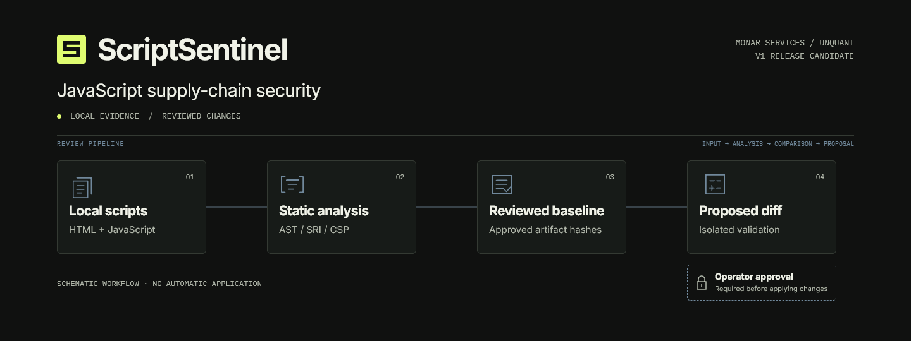
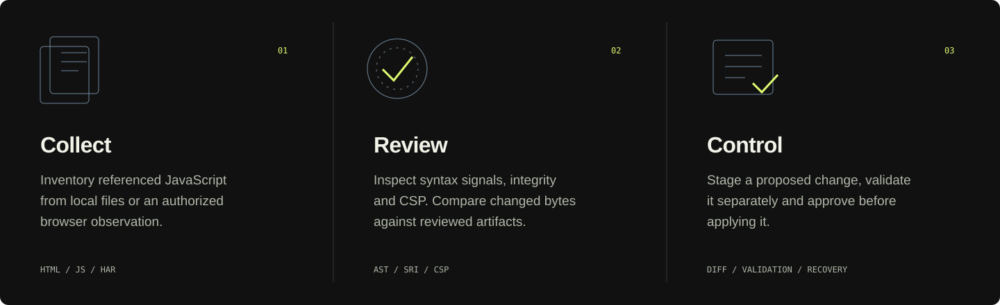
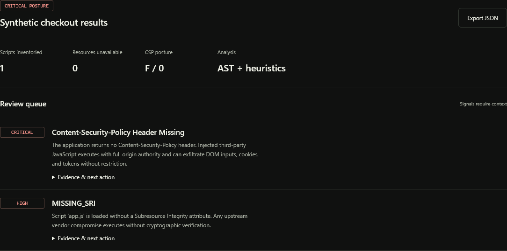
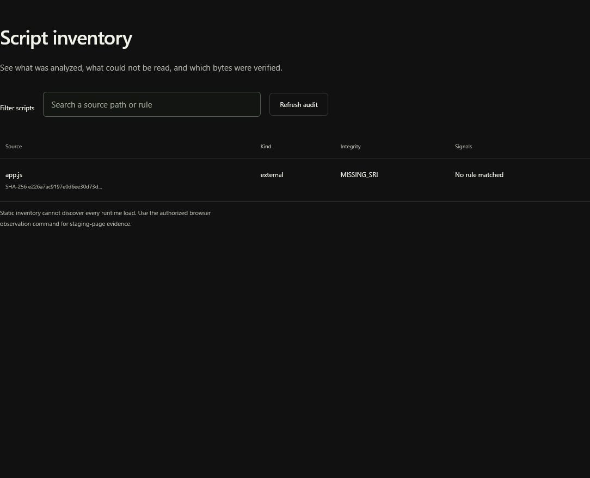
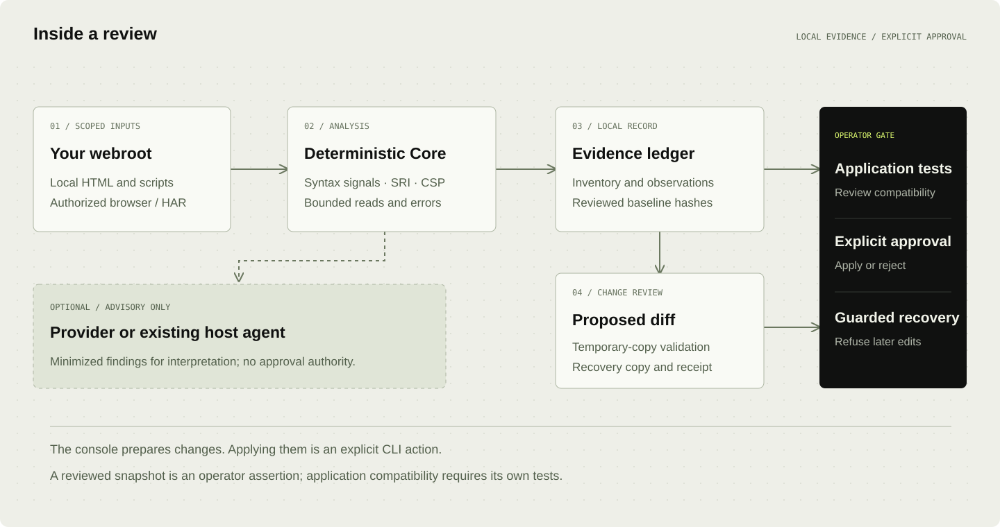

<!-- ScriptSentinel: JavaScript supply-chain security -->
<p align="center"></p>

<p align="center">
<a href="#start-in-two-minutes">Try the demo</a> &nbsp; / &nbsp;
<a href="#inside-a-review">How it works</a> &nbsp; / &nbsp;
<a href="docs/USER-GUIDE.md">User guide</a> &nbsp; / &nbsp;
<a href="docs/CASE-STUDY.md">OPTIMJACK</a> &nbsp; / &nbsp;
<a href="https://github.com/Monar-HQ/script-sentinel/actions/workflows/ci.yml">CI status</a>
</p>

**ScriptSentinel reviews the JavaScript delivered by your application.** Inventory scripts, inspect integrity and CSP, compare reviewed artifacts, and prepare changes for approval. Work in the local console, the CLI, or your existing AI agent.

| Version | Runtime | License | Operation |
| :--- | :--- | :--- | :--- |
| **1.0.0rc1** | Python **3.11.5+** | **MIT** | Local Core · optional AI |

<sub>Header: schematic workflow animation, not incident footage or a live audit. [View the static version](assets/workflow-poster.svg).</sub>

## Inside a review



One workflow connects the script inventory to the change decision. Unreadable resources and incomplete coverage remain visible in the report.

| You need to… | Use… | What you get |
| :--- | :--- | :--- |
| Review a webroot | `auto ./webroot --json` | Script inventory, syntax signals, integrity and CSP findings |
| Track approved content | `baseline` → `watch` | Persistent added, removed and changed events |
| Observe runtime loading | `observe-browser` or a HAR import | Scoped, authorized browser evidence |
| Prepare a change | `propose` → `validate-proposal` | A diff and temporary-copy validation results |
| Work with an AI agent | `mcp ./webroot` | Scoped, read-only host tools |

## Start in two minutes

From this checkout, create an isolated environment and run the bundled example:

```sh
python -m venv .venv
# Windows: .venv\Scripts\activate
# macOS / Linux: source .venv/bin/activate
python -m pip install .
scriptsentinel demo
scriptsentinel ui .
```

Open the private link printed in the terminal and select **Try the synthetic demo**. Then inspect your own webroot. No account or AI key is required for Core. Keep the terminal open while using the console. Python 3.12+ is recommended; the minimum supports the fixed HTML-selector dependency.

This checkout is a **release candidate**. The instructions install the code here, not an assumed newer version from a public package registry. `pipx install .` is also supported from the checkout.

## The working console

The bundled checkout intentionally lacks CSP and integrity metadata. This capture shows the actual findings, including their evidence and next actions.



<details>
<summary><strong>View the script inventory</strong></summary>



The console also includes baseline review, change checks, patch proposals, sourced research and a local activity ledger. It cannot silently apply changes to your application.

</details>

## From inventory to an approved change



<details>
<summary><strong>Diagram in text</strong></summary>

1. Read local HTML and referenced scripts, or import authorized browser evidence.
2. Produce deterministic syntax, integrity and CSP findings. Record unavailable resources.
3. Store observations and approved baseline hashes locally.
4. Prepare a proposed diff and validate it in a temporary copy.
5. Review application compatibility, then explicitly approve or reject the change.
6. Keep a recovery copy and receipt. Rollback refuses to overwrite later edits.

Optional provider or host-agent analysis interprets evidence; it has no approval authority. A snapshot records an operator review assertion, not a signed guarantee of trustworthy content.

</details>

<details>
<summary><strong>Run a reviewed SRI change, end to end</strong></summary>

Independently review the original artifacts first. Record who approved them and the release or commit reference:

```sh
scriptsentinel baseline ./webroot --reviewer "Security team" --provenance "Reviewed release reference" --approve
scriptsentinel propose ./webroot --file index.html --trusted-baseline ./webroot/.scriptsentinel/baseline.json --proposal proposed-fix.json
scriptsentinel validate-proposal ./webroot --trusted-baseline ./webroot/.scriptsentinel/baseline.json --proposal proposed-fix.json
# Review the diff and run your application's functional tests in isolation.
scriptsentinel apply-proposal ./webroot --trusted-baseline ./webroot/.scriptsentinel/baseline.json --proposal proposed-fix.json --approve
scriptsentinel watch ./webroot --interval 60
```

Stale resources, modified proposals and path escapes are refused. Validation checks staged SRI and script preservation; it does not replace application compatibility testing. See the [user guide](docs/USER-GUIDE.md) for recovery and rollback.

</details>

<details>
<summary><strong>Observe an authorized staging page</strong></summary>

```sh
python -m pip install ".[browser]"
python -m playwright install chromium
scriptsentinel observe-browser https://your-staging.example/checkout --authorized --allow-origin https://your-approved-cdn.example --output browser-evidence.json
```

Only named origins are allowed. Private/local addresses require `--allow-private`. The browser observes anonymous GET/HEAD requests and blocks state-changing requests, redirects, WebSockets and service workers. No login profile is copied. For untrusted pages, use a disposable VM/container with network egress controls; a browser context alone does not provide that isolation.

</details>

<details>
<summary><strong>Connect optional AI advice</strong></summary>

Anthropic, OpenAI, OpenRouter, Gemini and custom OpenAI-compatible endpoints are advisory adapters. Select a model available to your account and use official provider API credentials. Optional OS keychain storage:

```sh
python -m pip install ".[credentials]"
scriptsentinel credential-set openai
scriptsentinel auto ./webroot --ai --provider openai --model YOUR_MODEL
```

Audit advisory shares minimized rule IDs and counts. Credentials, source, paths, cookies and raw headers stay out of the request. Provider failures leave Core evidence available. Request and token limits bound calls; configure provider billing limits too. Model availability and subscription API entitlements depend on your provider.

Use `scriptsentinel mcp ./webroot` for read-only tools inside an existing host agent. See the [integration guide](docs/INTEGRATIONS.md).

</details>

## Research pack 001 · OPTIMJACK

V1 focuses on the defensive failure mode illustrated by OPTIMJACK: a trusted script delivery path can carry changed content.

| Evidence | Source and scope |
| :--- | :--- |
| Vendor incident | [Optimizely incident notice](https://status.optimizely.com/incidents/ftw0fh9wx43z): signup-flow compromise and cleanup |
| Vulnerability record | [CVE-2026-132224](https://cveawg.mitre.org/api/cve/CVE-2026-132224): CNA CVSS 4.0 **7.1 High** |
| Local historical lab | Separately attributed simulation records; no production exploitability or 9.5 CVSS claim |
| Extensible packs | Versioned provenance, applicability, revision history and license information |

Run `scriptsentinel research` to inspect the pack. [Read the case study](docs/CASE-STUDY.md) or [contribute sourced research](CONTRIBUTING.md). Lab IOCs are hunting leads, not proof of compromise; the demo contacts no malicious infrastructure.

## Documentation

| Getting started | Engineering and assurance | Contributing |
| :--- | :--- | :--- |
| [User guide](docs/USER-GUIDE.md) | [Architecture](docs/ARCHITECTURE.md) | [Contributor guide](CONTRIBUTING.md) |
| [AI and host integrations](docs/INTEGRATIONS.md) | [Threat model](THREAT_MODEL.md) | [Report a security issue](SECURITY.md) |
| [Supported environments](docs/SUPPORT.md) | [Executed validation](docs/VALIDATION.md) | [Research pack](research/optimjack-v1.json) |
| [Distribution](packaging/README.md) | [Release gates](docs/RELEASE.md) | [Identity assets](assets/brandkit/README.md) |

<details>
<summary><strong>Repository map</strong></summary>

```text
src/scriptsentinel/
  ast_analysis.py       Syntax-aware capability evidence
  auditor.py            Inventory, integrity and CSP
  browser.py            Authorized anonymous observation
  network.py            Origin scope and request limits
  monitoring.py         Reviewed snapshots and change events
  proposals.py          Deterministic SRI diffs
  validation.py         Staged validation and guarded recovery
  runtime.py            Local SQLite evidence ledger
  dashboard.py + web/   Private local console
  host.py + ai/         Read-only tools and provider advice
  knowledge/ + iocs/    Attributed research and hunting leads
tests/                  Boundary and end-to-end workflows
docs/                   Operations, architecture and evidence
packaging/              Distribution and reproducible previews
examples/synthetic/     Harmless demonstration fixtures
```

</details>

**Scope:** AST capabilities and heuristic signals do not prove malicious intent or provide whole-program dataflow analysis. CSP posture is not a full browser-policy oracle. Static inventory misses some runtime behavior. Fixed SRI may be incompatible with mutable vendor scripts. PCI mappings support evidence collection, not compliance certification. The ten-fixture `benchmark` measures disclosed syntax cases, not real-world malware detection accuracy.

## The collaboration

| MONAR Services | Unquant |
| :--- | :--- |
| **Ally** · Co-owner and developer | **Luke** · Owner |
| Product development and engineering | Provided the uncensored AI infrastructure for the original sandbox research and early development |
| [monarservices.org](https://www.monarservices.org/) | [unquant.io](https://unquant.io/) |

Roles were supplied by the project owner. [Credits and upstream acknowledgments](CREDITS.md) · [MIT license](LICENSE).
