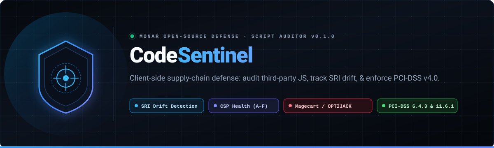
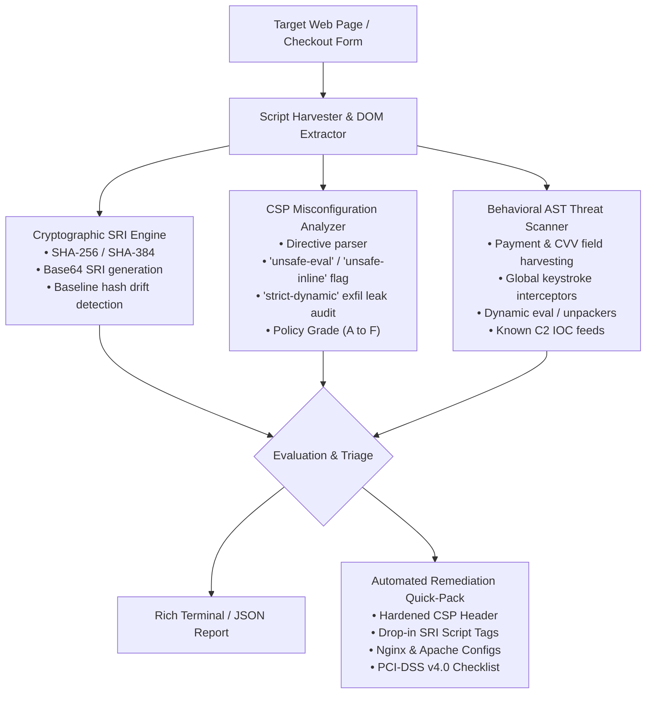

<p align="center">
  
</p>

<p align="center">
  <a href="https://github.com/Ally-Released/scriptsentinel/actions/workflows/ci.yml"></a>
  <a href="https://www.python.org/"></a>
  <a href="https://github.com/astral-sh/ruff"></a>
  <a href="LICENSE"></a>
  <a href="SECURITY.md"></a>
  <a href="https://www.pcisecuritystandards.org/"></a>
</p>

<p align="center">
  <b>CodeSentinel</b> (<code>scriptsentinel</code>) is a CLI-first open-source security tool designed to audit third-party JavaScript, detect client-side supply-chain compromises (Magecart, formjackers, OPTIJACK / CVE-2026-132224), monitor Subresource Integrity (SRI) drift, uncover fatal Content-Security-Policy (CSP) misconfigurations, and generate drop-in mitigations.
</p>

---

## 🎯 The Problem: Client-Side Blind Spots

Modern web applications embed dozens of external third-party scripts into the document root—analytics, tag managers, A/B testing SDKs, and customer support widgets. 

When an upstream vendor control plane or CDN is breached:
- Malicious payloads execute **directly in end-users' browsers**.
- Stolen credit cards, passwords, and PII are harvested **prior to transmission or encryption**.
- **WAFs, network firewalls, and server SIEMs are completely blind** because the malicious traffic never touches your backend servers.

```mermaid
flowchart LR
    subgraph Browser ["Victim Browser Session"]
        DOM["DOM & Payment Form"] -->|Scraped by Skimmer| TamperedScript["Compromised Vendor Tag"]
    end
    subgraph Vendor ["Upstream Vendor Plane"]
        CDN["Compromised CDN / S3"] -.->|Injects Unverified JS| TamperedScript
    end
    subgraph Adversary ["Adversary C2"]
        Sink["Exfiltration Endpoint"]
    end
    subgraph Perimeter ["Traditional Defenses (BLIND)"]
        WAF["WAF / Cloudflare"]
        SIEM["Server SIEM / Logs"]
    end
    TamperedScript -->|sendBeacon() / fetch()| Sink
    Perimeter -.->|No Visibility Into Client Memory| Browser
```

---

## 🛡️ How CodeSentinel Protects You



---

## ⚡ Comparison: Where CodeSentinel Fits

| Capability | WAF (Cloudflare/AWS) | SAST / DAST | CodeSentinel |
| :--- | :---: | :---: | :---: |
| Detects Upstream CDN Code Tampering | ❌ | ❌ | ✅ **Real-Time SRI Drift** |
| Flags Browser-Side Form Field Scraping | ❌ | ❌ | ✅ **AST Behavioral Heuristics** |
| Evaluates Runtime CSP Exfiltration Vectors | ⚠️ Partial | ⚠️ Static only | ✅ **Strict-Dynamic & Connect Audits** |
| Generates Drop-in Nonced CSP & SRI Tags | ❌ | ❌ | ✅ **Automated Quick-Pack** |
| PCI-DSS v4.0 Req 6.4.3 & 11.6.1 Proof | ❌ | ❌ | ✅ **Audit Ledger & Hash Pinning** |

---

## 🚀 Quick Start

### Installation

```bash
# Clone the repository
git clone https://github.com/Ally-Released/scriptsentinel.git
cd scriptsentinel

# Install locally in development mode
pip install -e .
```

*Requires Python 3.10+.*

---

### 1. Audit a Target Page

Audit any web application endpoint (e.g., checkout page, login portal):

```bash
scriptsentinel audit https://example.com/checkout
```

### 2. Monitor Upstream Script Drift Against Baselines

Pin approved script hashes and automatically flag upstream vendor alterations:

```bash
# First scan generates or validates against pinned baseline
scriptsentinel audit https://example.com/checkout --baseline baselines.json --output audit_report.json
```

### 3. Generate Drop-in Remediation Pack

Produce hardened CSP headers, Nginx/Apache configuration snippets, and drop-in `<script>` tags with computed SRI hashes:

```bash
scriptsentinel remediate https://example.com/checkout
```

---

## 🖥️ Live Terminal Output Preview

```text
  ____          _      ____             _   _            _ 
 / ___|___   __| | ___/ ___|  ___ _ __ | |_(_)_ __   ___| |
| |   / _ \ / _` |/ _ \___ \ / _ \ '_ \| __| | '_ \ / _ \ |
| |__| (_) | (_| |  __/___) |  __/ | | | |_| | | | |  __/ |
 \____\___/ \__,_|\___|____/ \___|_| |_|\__|_|_| |_|\___|_|
 Open-Source Client-Side Supply-Chain Defense & Script Auditor v0.1.0

┌────────────────────────── Audit Executive Summary ──────────────────────────┐
│ Target URL: https://example.com/checkout                                    │
│ HTTP Status: 200                                                            │
│ Overall Risk Rating: CRITICAL                                               │
│ CSP Health Grade: F (0/100)                                                 │
│ Total Scripts Discovered: 2 (2 external, 0 inline)                          │
└─────────────────────────────────────────────────────────────────────────────┘
                CSP Misconfigurations & Vulnerability Exposure                 
┌─────────────┬──────────┬──────────────────────────┬─────────────────────────┐
│ Rule ID     │ Severity │ Finding                  │ Actionable Remediation  │
├─────────────┼──────────┼──────────────────────────┼─────────────────────────┤
│ CSP-MISSING │ CRITICAL │ Content-Security-Policy  │ Deploy a strict CSP     │
│             │          │ Header Missing           │ enforcing nonces &      │
│             │          │                          │ restricted connect-src. │
└─────────────┴──────────┴──────────────────────────┴─────────────────────────┘
                  JavaScript Inventory, SRI & Behavioral Scan                  
┌───┬────────────────────┬─────────────┬─────────────────┬────────────────────┐
│ # │ Origin / Source    │ SRI Status  │ SHA-256 (Trunc) │ Threat Findings    │
├───┼────────────────────┼─────────────┼─────────────────┼────────────────────┤
│ 0 │ https://cdn.vendor │ MISSING_SRI │ 1ddc1b32fb1e... │ SKIM-EVAL-EXEC     │
│ 1 │ https://cdn.vendor │ SCRIPT_DRIFT│ e4bfd3a819c4... │ SKIM-INPUT-HARVEST │
└───┴────────────────────┴─────────────┴─────────────────┴────────────────────┘
```

---

## 📋 Compliance & Regulatory Mapping

| Standard | Section | CodeSentinel Enforcement Mechanism |
| :--- | :--- | :--- |
| **PCI-DSS v4.0** | **Requirement 6.4.3** | Maintains an automated inventory of all scripts running in consumer browsers, verifies written justification, and confirms Subresource Integrity (SRI). |
| **PCI-DSS v4.0** | **Requirement 11.6.1** | Deploys tamper-detection mechanisms (hash drift monitoring and CSP violation reporting) to alert security teams of unauthorized script modifications within 7 days. |
| **GDPR** | **Article 32** | Mitigates unauthorized exfiltration of consumer payment and identity records from client-side DOM forms. |

---

## 🗺️ Roadmap

- [x] CLI core engine with headless Chromium harvester
- [x] Subresource Integrity (SRI) calculator & drift tracker
- [x] CSP directive parser and grading engine (A–F)
- [x] AST-based behavioral skimmer pattern detector
- [x] OPTIJACK / CVE-2026-132224 threat intelligence feed integration
- [x] Remediation pack generator (Nginx, Apache, drop-in SRI tags)
- [ ] Automated Sigma rule & Suricata rule exporter
- [ ] Dark-mode standalone HTML executive report generator
- [ ] GitHub Action for automated CI/CD PR script drift gating

---

## 🤝 Contributing

We welcome contributions from security researchers, detection engineers, and developers!
- Review [`CONTRIBUTING.md`](CONTRIBUTING.md) to get started.
- Add new skimmer signatures or C2 drop domains via [Threat Intel Contribution Issue Template](https://github.com/Ally-Released/scriptsentinel/issues/new?template=threat_intel_rule.yml).
- Code format: `ruff check .` and tests: `pytest`.

---

## 🔒 Security Policy

For vulnerability disclosures or bug bounties, refer to [`SECURITY.md`](SECURITY.md). Please report security issues privately through [GitHub Security Advisories](https://github.com/Ally-Released/scriptsentinel/security/advisories).

---

## 📄 License

CodeSentinel is open-source software licensed under the **[MIT License](LICENSE)**.
