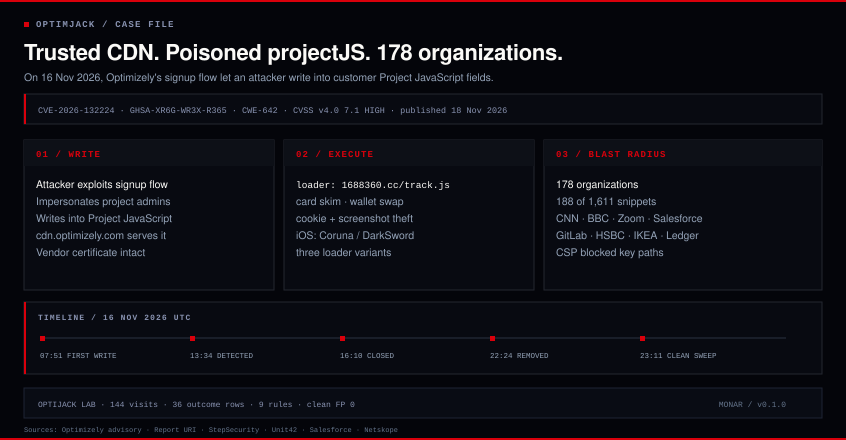

<p align="center">
  <picture>
    <source media="(prefers-color-scheme: dark)" srcset="assets/hero-banner-dark.svg">
    <source media="(prefers-color-scheme: light)" srcset="assets/hero-banner-light.svg">
    
  </picture>
</p>

<h3 align="center">Audit the JavaScript your checkout actually runs.</h3>

<p align="center">
  <sub><b>BY MONAR</b> · <a href="https://www.monarservices.org">monarservices.org</a></sub>
</p>

<p align="center">
  <a href="https://github.com/Ally-Released/scriptsentinel/actions/workflows/ci.yml"></a>
  
  
  
  
  
</p>

<p align="center">
  <a href="#live-audit">Live audit</a> ·
  <a href="#optimjack-case-study">OPTIMJACK case study</a> ·
  <a href="#what-it-checks">What it checks</a> ·
  <a href="#quick-start">Quick start</a> ·
  <a href="#ci-gate">CI gate</a> ·
  <a href="#pci-dss-v40">PCI-DSS</a> ·
  <a href="#documentation">Documentation</a>
</p>

---

**ScriptSentinel** is a CLI-first audit engine for third-party JavaScript. It inventories every script on a page, computes canonical SHA-256 and SHA-384 digests, verifies Subresource Integrity, grades Content-Security-Policy posture, scans for payment-card harvesting and known C2 indicators, and emits remediation plus PCI-DSS v4.0 evidence. Pure Python. No browser dependency. No telemetry.

> Checkout pages load scripts from vendors you do not control. A compromised vendor control plane runs malicious JavaScript inside the buyer's browser — after TLS, after WAF, after the SIEM. ScriptSentinel makes that layer auditable, reproducible, and gateable in CI.

## Live Audit

<p align="center">
  
</p>

Example run against the OPTIJACK simulation lab: `http://localhost:8100/no-csp/checkout`. The page returns HTTP 200, exposes one external script with no SRI, and ships no CSP header. The values shown match `report/no-csp.json`.

## OPTIMJACK Case Study

<p align="center">
  
</p>

On 16 November 2026, an attacker exploited Optimizely Web Experimentation's account signup flow and wrote malicious JavaScript into customer Project JavaScript fields. Optimizely's own CDN served 188 compromised snippets across 178 organizations, including CNN, BBC, Zoom, Salesforce, GitLab, HSBC, IKEA, and Ledger. The payload loaded `track.js` from `1688360[.]cc`, skimmed payment cards, swapped crypto wallet addresses, stole cookies and screenshots, and delivered iOS exploit kits. Optimizely closed the vulnerability at 16:10 UTC and removed the injected code by 22:24 UTC.

**CVE records:** [CVE.org](https://www.cve.org/CVERecord?id=CVE-2026-132224) · [NVD](https://nvd.nist.gov/vuln/detail/CVE-2026-132224) · [GHSA-XR6G-WR3X-R365](https://github.com/advisories/GHSA-XR6G-WR3X-R365) · [Rapid7](https://www.rapid7.com/db/vulnerabilities/cve-2026-132224/) · [Tenable](https://www.tenable.com/cve/CVE-2026-132224) · [ENISA EUVD](https://euvd.enisa.europa.eu/enisa/EUVD-2026-129010).

Read the full case study: [docs/CASE-STUDY.md](docs/CASE-STUDY.md) — timeline, attack chain, IOC analysis, OPTIJACK lab evidence, remediation, critical notes, and credits.

## What It Checks

| Plane | Engine | What it produces |
| --- | --- | --- |
| Inventory & integrity | `auditor.py`, `integrity.py` | External and inline script inventory; canonical SHA-256/SHA-384 digests; declared versus calculated SRI; drift against a pinned baseline. |
| CSP posture | `csp_analyzer.py` | Directive parsing with duplicate merge; six fatal/loose findings; 0–100 score; A–F grade. |
| Behavior | `scanner.py` | Payment/CVV harvesting, global input listeners, clipboard tampering, dynamic eval, base64 unpacking, `sendBeacon`, and IOC domain/hash matching. |
| Remediation | `remediate.py` | Hardened CSP header, drop-in SRI tags, Nginx/Apache configuration blocks, PCI-DSS 6.4.3 / 11.6.1 mapping. |
| Evidence | `report/`, `rules/` | Terminal summary, JSON, Markdown, standalone HTML, Sigma YAML, and Suricata HTTP/DNS rules. |

## Detection Rules

| Plane | Rule IDs |
| --- | --- |
| CSP | `CSP-MISSING`, `CSP-UNSAFE-EVAL`, `CSP-UNSAFE-INLINE`, `CSP-STRICT-DYNAMIC-RISK`, `CSP-CONNECT-WILDCARD`, `CSP-REPORTING-ABSENT` |
| SRI | `VERIFIED`, `MISSING_SRI`, `INTEGRITY_MISMATCH`, `SCRIPT_DRIFT` |
| Behavior | `SKIM-INPUT-HARVEST`, `SKIM-DOM-LISTENER`, `SKIM-CLIPBOARD-TAMPER`, `SKIM-EVAL-EXEC`, `SKIM-BASE64-UNPACK`, `SKIM-EXFIL-BEACON` |
| IOC | `IOC-MATCH-C2-DOMAIN`, `IOC-MATCH-C2-HASH` |

The full rule catalog, pattern logic, severities, and evidence fields are in [docs/DETECTION-RULES.md](docs/DETECTION-RULES.md). The OPTIJACK validation counts and source incident links are in [docs/CASE-STUDY.md](docs/CASE-STUDY.md#detection-validation).

## Quick Start

From the repository root:

```bash
python -m pip install -e ".[dev]"
# or: uv pip install -e ".[dev]"
```

| Command | Purpose | Example |
| --- | --- | --- |
| `audit` | Full page audit: scripts, SRI, CSP, behavior, remediation, evidence | `scriptsentinel audit https://checkout.example.com --baseline baselines/checkout.json --format json --output report.json --fail-on high` |
| `check-csp` | CSP-only analysis from a URL or a raw header | `scriptsentinel check-csp https://checkout.example.com` |
| `monitor` | Compare script hashes against a pinned baseline; exits non-zero on drift | `scriptsentinel monitor https://checkout.example.com --baseline baselines/checkout.json --alert-webhook https://hooks.example.com/csp` |
| `remediate` | Generate hardened CSP and copy-paste SRI tags | `scriptsentinel remediate https://checkout.example.com` |
| `export-rules` | Emit Sigma YAML or Suricata HTTP/DNS rules | `scriptsentinel export-rules --format sigma --output rules/sigma.yml` |

`audit --fail-on` accepts `none`, `low`, `medium`, `high`, `critical`, or `drift`. `monitor` returns exit code `1` when a pinned baseline hash changes. `scriptsentinel --version` prints the installed version.

## CI Gate

ScriptSentinel ships a composite action at the repository root and a reusable workflow at `.github/workflows/scriptsentinel-gate.yml`. Drop the action into any checkout-page pipeline:

```yaml
name: Script integrity gate

on: [pull_request]

jobs:
  scriptsentinel:
    runs-on: ubuntu-latest
    steps:
      - uses: actions/checkout@v4
      - uses: Ally-Released/scriptsentinel@main
        with:
          url: https://checkout.example.com
          baseline: baselines/checkout.json
          fail-on: drift
          report-path: scriptsentinel-report.json
      - uses: actions/upload-artifact@v4
        if: always()
        with:
          name: scriptsentinel-report
          path: scriptsentinel-report.json
```

Or call the reusable workflow directly:

```yaml
jobs:
  gate:
    uses: Ally-Released/scriptsentinel/.github/workflows/scriptsentinel-gate.yml@main
    with:
      url: https://checkout.example.com
      baseline: baselines/checkout.json
      fail-on: high
```

The action installs the package, runs `audit`, writes the JSON report, and fails the job at the requested threshold. Configuration details are in [docs/CI-GATE.md](docs/CI-GATE.md).

## PCI-DSS v4.0

| Requirement | Evidence ScriptSentinel produces |
| --- | --- |
| 6.4.3 — Manage scripts and other code loaded into payment pages | Script inventory, declared versus calculated SRI, CSP directives, and a pinned SHA-256 baseline for change detection. |
| 11.6.1 — Change- and tamper-detection for payment page HTTP headers and contents | SHA-256/SHA-384 digests, `SCRIPT_DRIFT` events, CSP violation reporting path, and deterministic JSON evidence. |

The full mapping, evidence fields, and remediation status is in [docs/PCI-DSS-MAPPING.md](docs/PCI-DSS-MAPPING.md). Incident context is in [docs/CASE-STUDY.md](docs/CASE-STUDY.md#what-scriptsentinel-contributes).

## Architecture

<p align="center">
  
</p>

The pipeline is deterministic and browser-free: `httpx` fetches the target, BeautifulSoup parses the HTML, `integrity.py` computes digests, `csp_analyzer.py` grades the policy, `scanner.py` inspects behavior and IOCs, and `remediate.py` builds the fix pack. See [docs/ARCHITECTURE.md](docs/ARCHITECTURE.md) for module boundaries, failure handling, and data contracts.

## Documentation

| Document | Contents |
| --- | --- |
| [docs/CASE-STUDY.md](docs/CASE-STUDY.md) | OPTIMJACK incident narrative, CVE links, timeline, IOC analysis, OPTIJACK lab evidence, remediation, critical notes, credits. |
| [docs/ARCHITECTURE.md](docs/ARCHITECTURE.md) | Data flow, module boundaries, typed contracts, failure handling. |
| [docs/DETECTION-RULES.md](docs/DETECTION-RULES.md) | CSP, SRI, behavioral, and IOC rule catalog. |
| [docs/PCI-DSS-MAPPING.md](docs/PCI-DSS-MAPPING.md) | PCI-DSS v4.0 6.4.3 / 11.6.1 evidence. |
| [docs/DESIGN.md](docs/DESIGN.md) | MONAR visual tokens, 846px asset standard, SVG rules. |
| [docs/CI-GATE.md](docs/CI-GATE.md) | Composite action, reusable workflow, exit codes. |
| [docs/RELEASE.md](docs/RELEASE.md) | Release-stage checklist, build artifacts, verification. |
| [CHANGELOG.md](CHANGELOG.md) | Version history and verification summary. |
| [CITATION.cff](CITATION.cff) | Citation metadata for research and incident reports. |

## Compute Partner

<p align="center">
  
</p>

[Unquant](https://unquant.io/) provided server infrastructure and AI compute access for the OPTIJACK simulation and model runs used to validate ScriptSentinel. Special thanks to Luke for championing open-source client-side defense research.

## Credits & Thanks

- **Goyya** — community feedback and release review.
- **Luke / Unquant** — infrastructure and AI compute for the OPTIJACK simulation and model validation.
- **Scott Helme / Report URI** — incident discovery, the 178-organization count, snippet analysis, and public IOC reporting.
- **Owais Shaikh / StepSecurity** — payload tracing, wallet analysis, attacker infrastructure, and the OPTIMJACK write-up.
- **Sherrod DeGrippo / Unit42** — third-party privilege and segmentation analysis.
- **Salesforce Security** — affected-organization response and exposure-window reporting.
- **Gianpietro Cutolo / Netskope Threat Labs** — attack-chain telemetry, iOS routing, and domain observations.
- **Optimizely** — vendor advisory, incident timeline, and remediation record.
- **Amirul Cyber** — campaign naming.
- **MITRE, NVD, CISA** — CVE record, CVSS metrics, and SSVC enrichment.

The full acknowledgement list and source provenance are in [docs/CASE-STUDY.md](docs/CASE-STUDY.md#credits-and-acknowledgements).

## Community

If ScriptSentinel helps your checkout integrity work, star the repository and share the OPTIMJACK case study. Questions and design notes belong in [GitHub Discussions](https://github.com/Ally-Released/scriptsentinel/discussions). Detection rules, IOC feeds, and docs are designed to be forked and extended.

## Citation

Use [CITATION.cff](CITATION.cff) for repository citation metadata. The incident analysis can be cited directly via [docs/CASE-STUDY.md](docs/CASE-STUDY.md).

## Contributing

Run the full gates before opening a pull request:

```bash
pytest -v
ruff check .
mypy --strict src/scriptsentinel
```

Read [CONTRIBUTING.md](CONTRIBUTING.md) for the module map, IOC feed schema, and test conventions. Security reports follow [SECURITY.md](SECURITY.md). The project is MIT licensed.

<p align="center">
  <sub>ScriptSentinel is a MONAR project. Built for checkout-page integrity.</sub>
</p>
