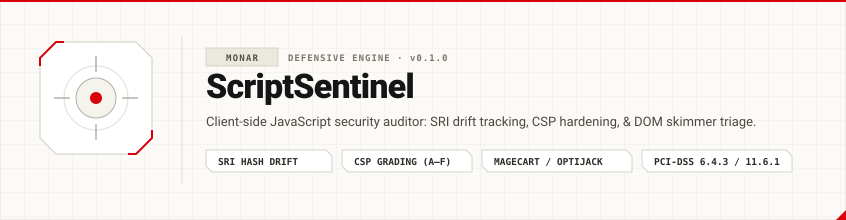

<div align="center">

<p align="center">
  <picture>
    <source media="(prefers-color-scheme: dark)" srcset="assets/hero-banner-dark.svg">
    
  </picture>
</p>

<p align="center">
  <a href="https://github.com/Ally-Released/scriptsentinel/actions/workflows/ci.yml"></a>
  
  
  
  <a href="LICENSE"></a>
</p>

<p align="center">
  <a href="#live-terminal-showcase">Terminal</a> ·
  <a href="#the-problem-client-side-blind-spots">The Problem</a> ·
  <a href="#system-architecture">Architecture</a> ·
  <a href="#quick-start">Quick Start</a> ·
  <a href="#pci-dss-v40-regulatory-mapping">PCI-DSS v4.0</a> ·
  <a href="docs/DETECTION-RULES.md">Detection Rules</a> ·
  <a href="#infrastructure--ai-partner">Partner</a>
</p>

</div>

---

## Live Terminal Showcase

Audit and evaluate any web application endpoint (e.g. checkout forms, authentication portals) with instant cryptographic hash drift tracking and CSP vulnerability scoring:

<div align="center">
  
</div>

---

## The Problem: Client-Side Blind Spots

Modern web applications embed dozens of external third-party scripts into the document root: tag managers, analytics, A/B experimentation SDKs, and payment widgets.

When an upstream vendor control plane or CDN is compromised:

- **Malicious code executes inside consumer browser sessions** within the origin context.
- **Credit card numbers, CVVs, and credentials are stolen prior to transmission or encryption** via DOM manipulation and global input listeners.
- **Traditional perimeter security is completely blind**: WAFs, firewalls, and server SIEMs never see the harvested data because it routes directly from the victim browser to adversary C2 endpoints.

```
+-----------------------------------------------------------------------------+
| Browser DOM & Payment Form                                                  |
|   |                                                                         |
|   +--> Compromised Third-Party Script (Injected via Vendor CDN / S3)        |
|          |                                                                  |
|          +--> Exfiltrates data via sendBeacon() / fetch()                   |
|                 |                                                           |
|                 v                                                           |
|        Adversary C2 Sink (Bypasses Backend SIEM & Perimeter WAFs Entirely)  |
+-----------------------------------------------------------------------------+
```

---

## System Architecture

CodeSentinel analyzes client-side attack surfaces across three distinct inspection vectors:

<div align="center">
  
</div>

1. **Cryptographic Integrity & Drift Engine**: Computes canonical SHA-256 and SHA-384 Subresource Integrity (SRI) hashes. When evaluated against pinned baselines, it immediately flags unauthorized upstream vendor script modifications.
2. **CSP Directive Analyzer**: Parses `Content-Security-Policy` headers, detects fatal keywords (`'unsafe-eval'`, `'unsafe-inline'`, loose `'strict-dynamic'`), flags wildcard exfiltration paths, and assigns a health grade (A to F).
3. **Behavioral AST & Threat Scanner**: Statically audits script content for payment field scraping, global input interception, dynamic code evaluation, base64 unpackers, and known adversary C2 IOCs.

---

## Defense Matrix

| Attack Vector / Defense Capability | Perimeter WAF | SAST / DAST | CodeSentinel |
| :--- | :---: | :---: | :---: |
| Detects Upstream CDN Code Tampering | No | No | **Real-Time SRI Drift** |
| Flags Browser-Side Form Field Scraping | No | No | **Behavioral AST Heuristics** |
| Discovers Runtime CSP Exfiltration Leaks | Partial | Static only | **Strict-Dynamic & Connect Audits** |
| Generates Drop-in Nonced CSP & SRI Tags | No | No | **Automated Quick-Pack** |
| Proves PCI-DSS v4.0 Req 6.4.3 & 11.6.1 | No | No | **Cryptographic Audit Ledger** |

---

## Quick Start

### Installation

```bash
# Clone the repository
git clone https://github.com/Ally-Released/scriptsentinel.git
cd scriptsentinel

# Install locally in editable mode
pip install -e .
```

*Requires Python 3.10 or higher.*

---

### 1. Audit a Target Endpoint

Scan any web application endpoint (checkout page, login form):

```bash
scriptsentinel audit https://example.com/checkout
```

### 2. Monitor Upstream Script Drift Against Baselines

Pin approved script hashes and automatically flag unexpected vendor alterations:

```bash
scriptsentinel audit https://example.com/checkout --baseline baselines.json --output audit_report.json
```

### 3. Generate Drop-in Remediation Pack

Produce hardened CSP headers, Nginx/Apache configuration blocks, and drop-in `<script>` tags with computed SRI hashes:

```bash
scriptsentinel remediate https://example.com/checkout
```

### 4. Export Executive Reports

Generate standalone dark-mode HTML executive reports or structured Markdown:

```bash
scriptsentinel audit https://example.com/checkout --html report.html
scriptsentinel audit https://example.com/checkout --markdown report.md
```

---

## PCI-DSS v4.0 Regulatory Mapping

CodeSentinel directly satisfies the client-side security mandates introduced in PCI-DSS v4.0:

| Requirement | Specification | Enforcement Mechanism |
| :--- | :--- | :--- |
| **Requirement 6.4.3** | All payment page scripts must be authorized, justified, and integrity-verified. | Maintains an automated inventory of scripts executing on checkout endpoints, confirms written business justification, and computes Subresource Integrity (SRI) attributes. |
| **Requirement 11.6.1** | Change- and tamper-detection mechanisms for payment page HTTP headers and script contents. | Tracks cryptographic script hash drift against approved baselines and verifies CSP violation telemetry streams. |

---

## Detection Rules & Heuristics

CodeSentinel enforces an extensible suite of detection rules:

- **CSP Misconfigurations**: `CSP-MISSING`, `CSP-UNSAFE-EVAL`, `CSP-UNSAFE-INLINE`, `CSP-CONNECT-WILDCARD`, `CSP-STRICT-DYNAMIC-EXFIL-RISK`, `CSP-REPORTING-ABSENT`.
- **Integrity & Drift**: `SCRIPT_DRIFT`, `INTEGRITY_MISMATCH`, `MISSING_SRI`, `VERIFIED`.
- **Behavioral Skimmer Heuristics**: `SKIM-INPUT-HARVEST`, `SKIM-DOM-LISTENER`, `SKIM-CLIPBOARD-TAMPER`, `SKIM-EVAL-EXEC`, `SKIM-BASE64-UNPACK`, `SKIM-EXFIL-BEACON`, and `IOC-MATCH-C2-DOMAIN` (OPTIJACK / CVE-2026-132224 threat feeds).

Read the complete catalog and severity ratings in **[`docs/DETECTION-RULES.md`](docs/DETECTION-RULES.md)**.

---

## Infrastructure & AI Partner

<div align="center">
  <a href="https://unquant.io/">
    
  </a>
</div>

<br>

CodeSentinel is supported by **[Unquant](https://unquant.io/)**, who provided the necessary high-performance compute and scalable AI model runtime access to conduct supply-chain simulations, fuzz tampered script variants, and benchmark drift detection algorithms.

> *Special thanks to **Luke** at Unquant for his dedication and extraordinary support in advancing open-source defensive security research.*

---

## Documentation Suite

- **[`docs/ARCHITECTURE.md`](docs/ARCHITECTURE.md)**: Data flow, headless DOM hooks, hash computation engine, and AST analyzer.
- **[`docs/PCI-DSS-MAPPING.md`](docs/PCI-DSS-MAPPING.md)**: Requirement 6.4.3 & 11.6.1 compliance ledger and operational evidence.
- **[`docs/DETECTION-RULES.md`](docs/DETECTION-RULES.md)**: Catalog of all detection rules, severity grades, and remediation guidance.

---

## Contributing

We welcome contributions from security researchers, detection engineers, and developers:

- Review [`CONTRIBUTING.md`](CONTRIBUTING.md) to get started.
- Propose new C2 drop domains or skimmer signatures via the [Threat Intel Contribution Issue Template](https://github.com/Ally-Released/scriptsentinel/issues/new?template=threat_intel_rule.yml).
- Verification requirements: `ruff check .` and `pytest`.

---

## Security Policy

For vulnerability disclosures, refer to [`SECURITY.md`](SECURITY.md). Please report vulnerabilities privately through [GitHub Security Advisories](https://github.com/Ally-Released/scriptsentinel/security/advisories).

---

## License

CodeSentinel is open-source software licensed under the **[MIT License](LICENSE)**.

<br>

<div align="center">
<sub>Crafted with conviction by <a href="https://www.monarservices.org/">MONAR</a>. Chances make Champions.</sub>
</div>
