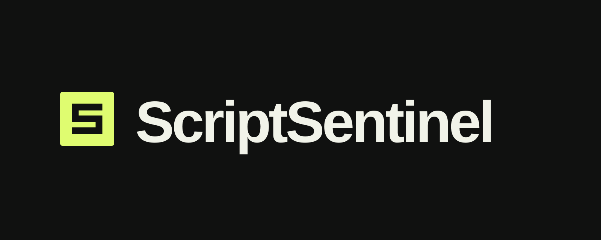
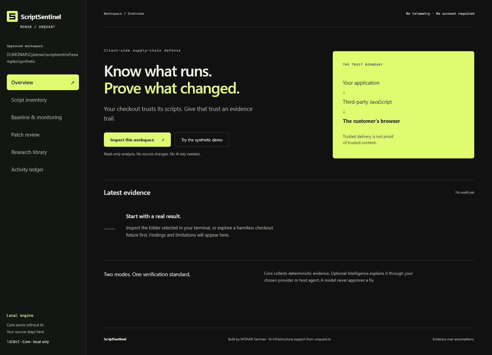
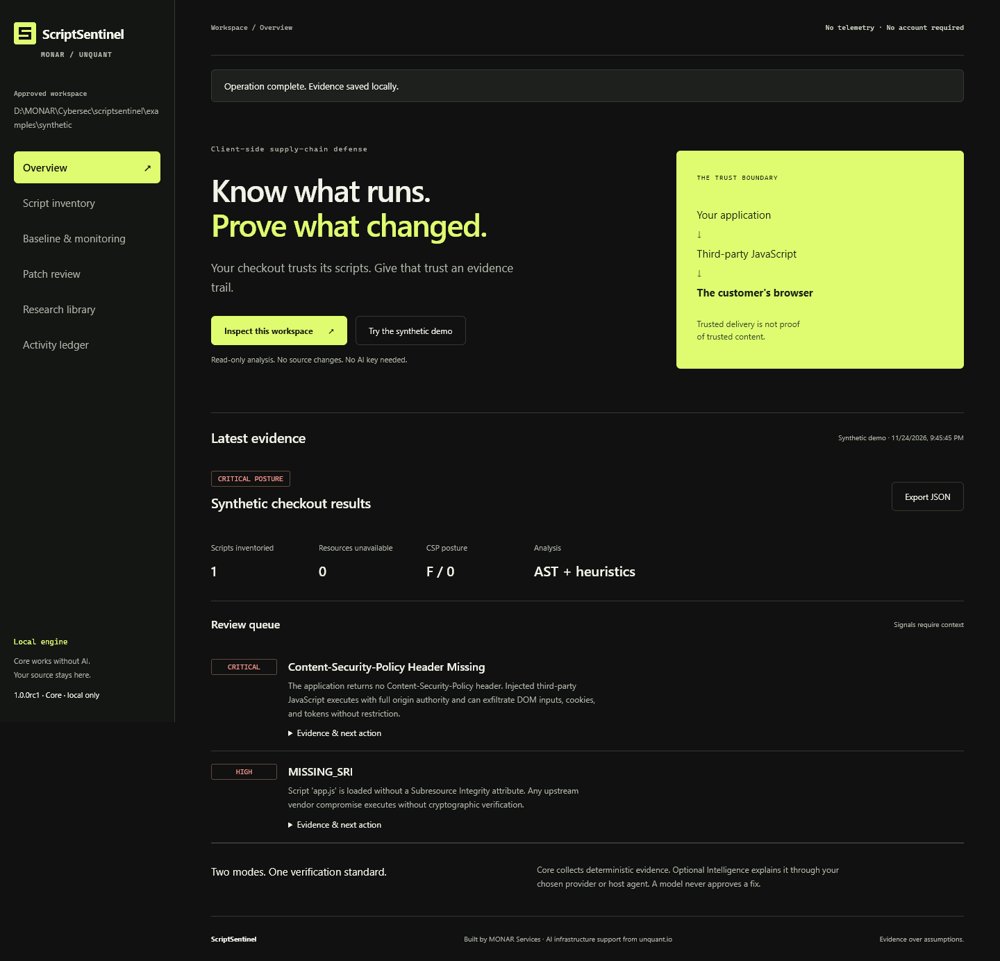
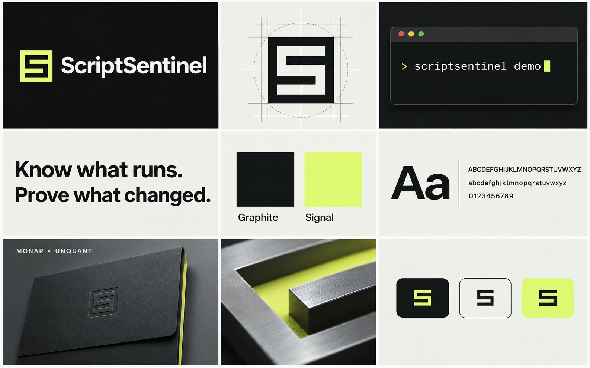

<!-- ScriptSentinel: local-first client-side supply-chain defense -->
<p align="center"></p>

<p align="center">
<a href="#start-in-two-minutes">Start here</a> ·
<a href="docs/USER-GUIDE.md">User guide</a> ·
<a href="docs/ARCHITECTURE.md">Architecture</a> ·
<a href="docs/CASE-STUDY.md">OPTIMJACK research</a> ·
<a href="THREAT_MODEL.md">Trust boundaries</a> ·
<a href="CREDITS.md">The collaboration</a>
</p>

**ScriptSentinel makes the JavaScript your application trusts inspectable.** Inventory scripts, parse their syntax, check integrity and CSP posture, review changes against approved artifacts, and prepare fixes with an evidence trail. Use the private local console, the CLI, or read-only tools inside your existing AI agent.

**Core needs no AI key. Intelligence is optional. Every model faces the same verification gate.**

<p align="center"></p>

## Start in two minutes

From this repository checkout, install into an isolated environment:

Use **Python 3.11.5 or newer** (3.12+ recommended). This minimum permits the
upstream fixed HTML-selector dependency; older Python runtimes are unsupported.

```sh
python -m venv .venv
# Windows: .venv\Scripts\activate
# macOS / Linux: source .venv/bin/activate
python -m pip install .
scriptsentinel demo
scriptsentinel ui .
```

Open the private link printed in the terminal. Try **the synthetic demo**, then inspect your own web root. No signup, no telemetry, no production changes. Keep the terminal open while using the console.

Prefer pipx? Run `pipx install .` from this checkout. The code here is a **v1 release candidate**, not a claim that a published package already includes these changes.

## From a signal to a decision

| Your question | The working path |
| --- | --- |
| What scripts does this checkout reference? | `scriptsentinel auto ./webroot --json` — local inventory, AST capability signals, heuristic rules and integrity |
| Did approved content change? | Pin reviewed artifacts with `baseline`, then run `watch` — durable added/removed/changed events |
| What does the browser actually request? | `observe-browser` — an authorized, bounded anonymous staging-page observation; or import a single-page HAR |
| Can I inspect the fix first? | `propose` → `validate-proposal` → application review → `apply-proposal --approve` |
| Can my existing AI help? | `mcp ./webroot` exposes scoped read-only tools; no separate provider key is needed for host reasoning |
| Can I use my own provider? | Opt in with `auto --ai`; official provider API keys or a configured local endpoint |

The local console joins inventory, evidence, research, baseline review, change checks and staged SRI proposals. **It cannot silently apply changes.** Application and production approval stay explicit.

<p align="center"></p>

## A reviewed fix, end to end

First verify the original artifacts independently. Record the reviewer and release/commit reference:

```sh
scriptsentinel baseline ./webroot --reviewer "Security team" --provenance "Reviewed release reference" --approve
scriptsentinel propose ./webroot --file index.html --trusted-baseline ./webroot/.scriptsentinel/baseline.json --proposal proposed-fix.json
scriptsentinel validate-proposal ./webroot --trusted-baseline ./webroot/.scriptsentinel/baseline.json --proposal proposed-fix.json
# Review the complete diff and run your application's functional tests in isolation.
scriptsentinel apply-proposal ./webroot --trusted-baseline ./webroot/.scriptsentinel/baseline.json --proposal proposed-fix.json --approve
scriptsentinel watch ./webroot --interval 60
```

A snapshot is an operator review assertion, not a signed guarantee. ScriptSentinel refuses stale resources, modified proposals and path escapes. It stages candidate bytes, checks SRI and script preservation, creates a recovery copy and replaces one file atomically. A receipt supports `rollback` and refuses to overwrite later edits.

## Authorized browser observation

```sh
python -m pip install ".[browser]"
python -m playwright install chromium
scriptsentinel observe-browser https://your-staging.example/checkout --authorized --allow-origin https://your-approved-cdn.example --output browser-evidence.json
```

Only named origins are allowed. Private/local addresses require `--allow-private`. Anonymous GET/HEAD requests are observed; state-changing requests, redirects, WebSockets and service workers are blocked. No login session is copied. Use a disposable VM/container with network egress controls for untrusted pages: a browser context alone is not a security sandbox.

## Intelligence without surrendering control

Anthropic, OpenAI, OpenRouter, Gemini and custom OpenAI-compatible endpoints are advisory adapters. Choose an explicit model available to your account. Optional OS keychain storage:

```sh
python -m pip install ".[credentials]"
scriptsentinel credential-set openai
scriptsentinel auto ./webroot --ai --provider openai --model YOUR_MODEL
```

Audit advisory shares minimized rule IDs and counts. Credentials, source, paths, cookies and raw headers stay out of that request. Provider outages and invalid responses leave Core evidence available. Request and token limits bound calls; use provider billing limits as well. Model availability, price and subscription API entitlements are provider-specific.

Read-only host-agent setup and advisory responsibilities are in [the integration guide](docs/INTEGRATIONS.md).

## Research with receipts

The v1 focus is **OPTIMJACK and the broader defensive failure mode it illustrates: trusted script delivery can carry changed content**.

The [Optimizely incident notice](https://status.optimizely.com/incidents/ftw0fh9wx43z) confirms the signup-flow compromise and cleanup. The [CVE Program record](https://cveawg.mitre.org/api/cve/CVE-2026-132224) identifies CVE-2026-132224 and lists a CNA CVSS 4.0 score of **7.1 High**. Historical local simulation results are separate evidence; they do not establish production exploitability, incident scale or a 9.5 CVSS score.

`scriptsentinel research` prints the versioned source pack. New packs are data with provenance, applicability, revision history and license information. Existing lab IOC records are hunting leads with lab provenance, not proof of compromise. No malicious infrastructure is contacted by the demo.

## Know the limits

AST signals identify syntax and capabilities; regex signals remain heuristics. Neither proves malicious intent or supplies whole-program dataflow analysis. CSP posture is not a full browser policy oracle. Static inventory misses some runtime behavior. Mutable vendor scripts may be incompatible with fixed SRI. Application compatibility needs functional review. PCI mappings aid evidence collection; they do not certify compliance.

The test suite, optional Chromium workflows, synthetic corpus, packaging checks and release gates are documented in [validation](docs/VALIDATION.md). `scriptsentinel benchmark` measures a disclosed ten-fixture AST corpus, not real-world malware detection accuracy.

## Built to be maintained

```text
src/scriptsentinel/
  ast_analysis.py       Syntax-aware capability evidence
  auditor.py            Page inventory, integrity and CSP
  browser.py            Authorized anonymous observation
  local_audit.py        Offline workspace analysis
  network.py            Destination scope and request limits
  monitoring.py         Reviewed snapshots and change events
  proposals.py          Deterministic SRI diffs
  validation.py         Staged validation and guarded recovery
  runtime.py            Local SQLite evidence ledger
  dashboard.py + web/   Private local console
  host.py + ai/         Host tools and optional provider advice
  knowledge/ + iocs/    Attributed research and hunting leads
tests/                  Unit, boundary and end-to-end workflows
docs/                   Operation, architecture and evidence
packaging/              Distribution and reproducible previews
examples/synthetic/     Harmless demonstration fixtures
```

[Contribute](CONTRIBUTING.md) · [Report a security issue](SECURITY.md) · [Release criteria](docs/RELEASE.md) · [MIT license](LICENSE)

## The people behind it

<details>
<summary>Explore the ScriptSentinel identity system</summary>



Brand concept artwork, not a product screenshot. [Design rationale and generation prompt](assets/brandkit/README.md).

</details>

**Ali — co-owner and developer, MONAR Services.** Product development and engineering.

**Luke — owner, unquant.io.** Provided the uncensored AI infrastructure used for the original sandbox research and early development.

Collaboration roles were supplied by the project owner. See [credits and upstream acknowledgments](CREDITS.md). The engineering standard is the same regardless of which model helps.

---

Built by [MONAR Services](https://www.monarservices.org/) with AI infrastructure support from [unquant.io](https://unquant.io/). Evidence over assumptions.
