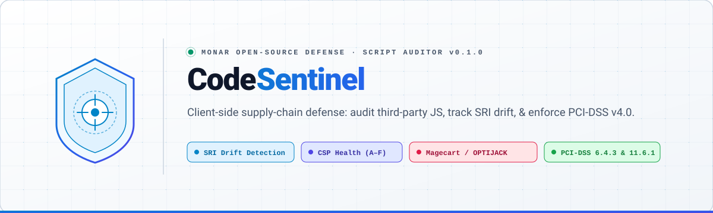
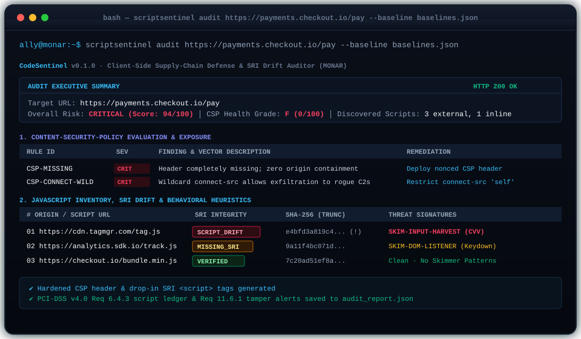
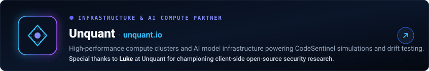

<p align="center">
  <picture>
    <source media="(prefers-color-scheme: dark)" srcset="assets/banner-dark.svg">
    
  </picture>
</p>

<h3 align="center">Client-side supply-chain defense &amp; real-time JavaScript drift tracking.</h3>
<p align="center"><sub><b>BY MONAR</b></sub></p>

<p align="center">
  Audits third-party JavaScript, detects client-side formjackers (Magecart &amp; OPTIJACK),<br>
  tracks Subresource Integrity (SRI) baseline drift, uncovers fatal CSP misconfigurations, and generates drop-in remediations.
</p>

<p align="center">
  <a href="https://github.com/Ally-Released/scriptsentinel/actions/workflows/ci.yml"></a>
  
  
  
  <a href="LICENSE"></a>
</p>

<p align="center">
  <a href="#-live-terminal-showcase"><b>Live Terminal</b></a> ·
  <a href="#-the-problem-client-side-blind-spots"><b>The Problem</b></a> ·
  <a href="#-system-architecture"><b>Architecture</b></a> ·
  <a href="#-quick-start"><b>Quick Start</b></a> ·
  <a href="#-pci-dss-v40-regulatory-mapping"><b>PCI-DSS v4.0</b></a> ·
  <a href="docs/DETECTION-RULES.md"><b>Detection Rules</b></a> ·
  <a href="#-infrastructure--ai-partner"><b>Partner &amp; Sponsor</b></a>
</p>

---

## 🖥️ Live Terminal Showcase

Inspect and evaluate any web application endpoint (e.g., checkout page, login portal) with instant cryptographic drift tracking:

<p align="center">
  
</p>

---

## 🎯 The Problem: Client-Side Blind Spots

Modern web applications embed dozens of external third-party scripts into the document root—analytics, tag managers, A/B testing SDKs, and customer support widgets. 

When an upstream vendor control plane, CDN, or AWS S3 bucket is compromised:
- **Malicious payloads execute directly in consumer browsers** within the origin context.
- **Credit cards, passwords, and PII are harvested prior to transmission or encryption** via DOM manipulation and input interception.
- **Traditional WAFs, network firewalls, and server SIEMs are completely blind** because the malicious traffic never touches your backend servers.

```mermaid
flowchart LR
    subgraph Browser ["Victim Browser Session"]
        DOM["DOM & Payment Form"] -->|Scraped by Skimmer| TamperedScript["Compromised Vendor Tag"]
    end
    subgraph Vendor ["Upstream Vendor Plane"]
        CDN["Compromised CDN / S3"] -.->|Injects Unverified JS| TamperedScript
    end
    subgraph Adversary ["Adversary C2"]
        Sink["Exfiltration Endpoint"]
    end
    subgraph Perimeter ["Traditional Defenses (BLIND)"]
        WAF["WAF / Cloudflare"]
        SIEM["Server SIEM / Logs"]
    end
    TamperedScript -->|sendBeacon() / fetch()| Sink
    Perimeter -.->|No Visibility Into Client Memory| Browser
```

> **Why we built this.** I'm Ally, head developer at [MONAR](https://www.monarservices.org). Attackers no longer bother trying to break hardened enterprise backends when they can compromise an obscure third-party analytics tag or chat widget and siphon raw customer credit cards straight out of the DOM. Server-side WAFs can't see client memory. CodeSentinel gives security engineers, compliance leads, and developers deterministic cryptographic visibility and immediate remediation.

---

## ⚡ Comparison: Where CodeSentinel Fits

| Capability | WAF (Cloudflare/AWS) | SAST / DAST | CodeSentinel |
| :--- | :---: | :---: | :---: |
| **Detects Upstream CDN Code Tampering** | ❌ Blind | ❌ Static only | ✅ **Real-Time Cryptographic SRI Drift** |
| **Flags Browser-Side Form Field Scraping** | ❌ Blind | ❌ False-positive heavy | ✅ **Targeted AST Behavioral Heuristics** |
| **Evaluates Runtime CSP Exfiltration Vectors** | ⚠️ Partial | ⚠️ Header presence only | ✅ **Strict-Dynamic & connect-src Audits** |
| **Generates Drop-in Nonced CSP & SRI Tags** | ❌ No | ❌ No | ✅ **Automated Remediation Quick-Pack** |
| **PCI-DSS v4.0 Req 6.4.3 & 11.6.1 Proof** | ❌ No | ❌ No | ✅ **Automated Audit Ledger & Hash Pinning** |
| **Runtime Performance Impact** | 1–5ms | N/A (Build only) | ✅ **0ms (Out-of-band audit & CI gating)** |

---

## 🏛️ System Architecture

CodeSentinel couples headless DOM harvesting with a high-throughput parallel evaluation pipeline:

<p align="center">
  
</p>

For a technical deep dive into internal modules, data flow, memory model, and concurrency guarantees, see **[`docs/ARCHITECTURE.md`](docs/ARCHITECTURE.md)**.

---

## 🚀 Quick Start

### Installation

Requires **Python 3.10+**. Install locally in development mode:

```bash
# Clone repository
git clone https://github.com/Ally-Released/scriptsentinel.git
cd scriptsentinel

# Install package
pip install -e .
```

---

### 1. Audit a Target Page

Audit any web application endpoint (e.g., checkout page, login portal):

```bash
scriptsentinel audit https://example.com/checkout
```

### 2. Monitor Upstream Script Drift Against Baselines

Pin approved script hashes and automatically flag upstream vendor alterations:

```bash
# First scan generates or validates against pinned baseline
scriptsentinel audit https://example.com/checkout --baseline baselines.json --output audit_report.json
```

### 3. Generate Drop-in Remediation Pack

Produce hardened CSP headers with cryptographic nonces, Nginx/Apache configuration snippets, and drop-in `<script>` tags with computed SRI hashes:

```bash
scriptsentinel remediate https://example.com/checkout
```

---

## 📋 PCI-DSS v4.0 Regulatory Mapping

PCI-DSS v4.0 mandates strict client-side controls for all payment-processing web pages:

| Standard | Section | CodeSentinel Enforcement Mechanism | Technical Guide |
| :--- | :--- | :--- | :---: |
| **PCI-DSS v4.0** | **Requirement 6.4.3** | Maintains an automated inventory of all scripts running in consumer browsers, verifies written justification, and confirms Subresource Integrity (SRI). | [**Read Mapping**](docs/PCI-DSS-MAPPING.md#2-requirement-643-script-authorization--integrity-verification) |
| **PCI-DSS v4.0** | **Requirement 11.6.1** | Deploys tamper-detection mechanisms (hash drift monitoring and CSP violation reporting) to alert security teams of unauthorized script modifications within 7 days. | [**Read Mapping**](docs/PCI-DSS-MAPPING.md#3-requirement-1161-tamper--and-drift-detection-mechanisms) |
| **GDPR** | **Article 32** | Mitigates unauthorized exfiltration of consumer payment and identity records from client-side DOM forms. | [**Read Architecture**](docs/ARCHITECTURE.md) |

For complete implementation workflows, evidence gathering, and QSA audit preparation, see **[`docs/PCI-DSS-MAPPING.md`](docs/PCI-DSS-MAPPING.md)**.

---

## 🔍 Detection Rules & Heuristics

CodeSentinel enforces an extensible suite of detection rules across CSP headers, cryptographic SRI, and behavioral script AST analysis:

- **CSP Misconfigurations**: `CSP-MISSING`, `CSP-UNSAFE-EVAL`, `CSP-UNSAFE-INLINE`, `CSP-CONNECT-WILDCARD`, `CSP-STRICT-DYNAMIC-EXFIL-RISK`, `CSP-REPORTING-ABSENT`.
- **Integrity & Drift**: `SCRIPT_DRIFT`, `INTEGRITY_MISMATCH`, `MISSING_SRI`, `VERIFIED`.
- **Behavioral Skimmer Heuristics**: `SKIM-INPUT-HARVEST`, `SKIM-DOM-LISTENER`, `SKIM-CLIPBOARD-TAMPER`, `SKIM-EVAL-EXEC`, `SKIM-BASE64-UNPACK`, `SKIM-EXFIL-BEACON`, and `IOC-MATCH-C2-DOMAIN` (OPTIJACK / CVE-2026-132224 threat feeds).

Read the complete catalog and severity grading in **[`docs/DETECTION-RULES.md`](docs/DETECTION-RULES.md)**.

---

## 🤝 Infrastructure & AI Partner

<p align="center">
  <a href="https://unquant.io/">
    
  </a>
</p>

CodeSentinel is supported by **[Unquant](https://unquant.io/)**, who provided the necessary high-performance GPU and server infrastructure alongside scalable AI access to conduct extensive client-side supply-chain simulations, fuzz script tampered payloads, and benchmark drift detection algorithms.

> *Special thanks to **Luke** at Unquant for his extraordinary support and commitment to advancing open-source security research.*

---

## 🗺️ Roadmap

- [x] CLI core engine with headless Chromium harvester
- [x] Subresource Integrity (SRI) calculator & drift tracker
- [x] CSP directive parser and grading engine (A–F)
- [x] AST-based behavioral skimmer pattern detector
- [x] OPTIJACK / CVE-2026-132224 threat intelligence feed integration
- [x] Remediation pack generator (Nginx, Apache, drop-in SRI tags)
- [x] Comprehensive documentation suite (`ARCHITECTURE.md`, `PCI-DSS-MAPPING.md`, `DETECTION-RULES.md`)
- [ ] Automated Sigma rule & Suricata rule exporter
- [ ] Standalone dark-mode HTML executive report generator
- [ ] GitHub Action for automated CI/CD PR script drift gating

---

## 🤝 Contributing

We welcome contributions from security researchers, detection engineers, and developers!
- Review [`CONTRIBUTING.md`](CONTRIBUTING.md) to get started.
- Add new skimmer signatures or C2 drop domains via [Threat Intel Contribution Issue Template](https://github.com/Ally-Released/scriptsentinel/issues/new?template=threat_intel_rule.yml).
- Code format: `ruff check .` and tests: `pytest`.

---

## 🔒 Security Policy

For vulnerability disclosures or bug bounties, refer to [`SECURITY.md`](SECURITY.md). Please report security issues privately through [GitHub Security Advisories](https://github.com/Ally-Released/scriptsentinel/security/advisories).

---

## 📄 License

CodeSentinel is open-source software licensed under the **[MIT License](LICENSE)**.
<br>
<sub>Crafted with conviction by <a href="https://www.monarservices.org/">MONAR</a>. Chances make Champions.</sub>
