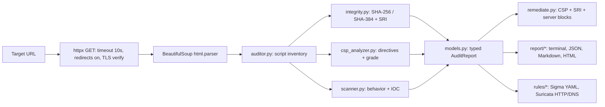

# ScriptSentinel Architecture

ScriptSentinel is a deterministic, browser-free audit pipeline for third-party JavaScript on payment and checkout pages. The engine fetches a target, parses the document, computes cryptographic digests, grades the Content-Security-Policy, scans script behavior and IOC exposure, and emits remediation and evidence.

  

## Pipeline

## Module Boundaries

| Module | Responsibility | Inputs | Outputs |
| --- | --- | --- | --- |
| `auto.py` | Autonomous end-to-end pipeline orchestrating recon, audit, multi-provider AI reasoning, and automated patching. | Target URL or directory, patch flags, AI config. | `AutoResult`. |
| `env_detector.py` | Auto-detect web servers (Nginx, Apache, Caddy, Cloudflare), frameworks (Next.js, Express, Django), HTML files, and script elements. | Target URL or path, optional HTTP client. | `EnvironmentProfile`. |
| `ai/client.py` | Zero-dependency multi-provider AI client supporting Anthropic, OpenAI, OpenRouter, and custom endpoints via `httpx`. | System/user prompt, AI config. | AI completion text. |
| `ai/agent.py` | Autonomous security agent formulating threat narratives, surgical CSP policies, and PCI-DSS v4.0 CISO briefings. | `AuditReport`, `EnvironmentProfile`. | `AIAuditAnalysis`. |
| `patcher.py` | Surgical automated patching: injects SRI hashes into `<script>` tags, updates Nginx/server configs with hardened CSP, and supports safety rollback. | HTML / Nginx file paths, hardened CSP. | `PatchResult`. |
| `auditor.py` | Fetch target, parse HTML, collect inline and external `<script>` elements, build the complete audit report. | URL, optional baseline map, timeout, optional `httpx` transport. | `AuditReport`. |
| `integrity.py` | Compute SHA-256/SHA-384 hex and SRI base64 digests; compare declared integrity and pinned baseline. | Script bytes, declared integrity, baseline SHA-256. | `ScriptIntegrityResult`, `HashDigests`, `IntegrityIssue`. |
| `csp_analyzer.py` | Parse CSP directives, merge duplicate directives, apply penalties, grade A–F. | Raw CSP header or `None`. | `CSPAnalysis`. |
| `scanner.py` | Match payment-field harvesting, listeners, clipboard access, eval, base64 unpacking, beacons, and IOC domains/hashes. | JavaScript source and script name. | `ScanResult`, `ScanFinding`. |
| `remediate.py` | Build hardened CSP, SRI replacement tags, Nginx/Apache blocks, PCI-DSS mapping. | Site URL, CSP analysis, script inventory. | `RemediationPack`. |
| `report/*` | Render standalone evidence in terminal, JSON, Markdown, HTML. | `AuditReport`. | Report files and strings. |
| `rules/*` | Export Sigma YAML and Suricata HTTP/DNS rules from the packaged IOC feed and optional audit. | Feed records, optional `AuditReport`. | Rule files. |
| `iocs/loader.py` | Load, validate, merge, and digest versioned IOC feeds. | Feed JSON path or packaged resource. | `IOCFeed`, `IOCRecord`. |
| `cli.py` | Parse subcommands (`auto`, `fix`, `setup`, `audit`, `check-csp`, `monitor`, `remediate`, `export-rules`), render Rich output, write reports, return CI exit codes. | CLI argv. | Terminal output, files, exit code. |

## Typed Contract

`models.py` is the frozen shared contract. Engines return typed dataclasses with `to_dict()` projections for reporters:

- `Finding`
- `CSPAnalysis`
- `HashDigests`
- `IntegrityIssue`
- `ScriptIntegrityResult`
- `ScanFinding`
- `ScanResult`
- `ScriptAudit`
- `ScriptTagReplacement`
- `ComplianceItem`
- `RemediationPack`
- `AuditReport`

The package ships `py.typed` for PEP 561 consumers.

## Failure Handling

- Fetch failures produce `AuditReport(overall_risk="ERROR", error=...)` with an empty script inventory.
- HTML parse failures are recorded in `AuditReport.error`; the audit continues with zero scripts.
- External script fetch failures produce `ScriptAudit.error` and `FETCH_FAILED` in report output.
- Remediation failures are recorded in `AuditReport.error`; the rest of the report remains valid.
- `httpx.AsyncClient` uses `timeout=10.0`, `follow_redirects=True`, and `verify=True`.
- Malformed CSP headers are parsed permissively; missing headers produce `CSP-MISSING` with score 0 / grade F.
- IOC feeds reject records without `source` or `first_seen`; malformed feeds raise `IOCError`.

## Determinism

- No browser dependency, no JavaScript execution, no telemetry, no phone-home.
- Timestamps are UTC ISO-8601 strings.
- Reporters render from typed dataclasses, not ad hoc dictionaries.
- External requests are limited to the target URL and optional drift webhook.
- SRI digests are computed from the exact fetched bytes.

## Runtime Dependencies

| Dependency | Use |
| --- | --- |
| `httpx` | Async HTTP fetch and optional webhook delivery. |
| `beautifulsoup4` | HTML parsing with `html.parser`. |
| `rich` | CLI panels, tables, and banner rendering. |
| `PyYAML` | Sigma rule serialization in `rules/sigma_exporter.py`. |

Development dependencies: `pytest`, `pytest-cov`, `ruff`, `mypy`, `types-pyyaml`.

## Security Boundaries

- TLS verification is enabled.
- Redirects are followed, but the final response URL is used to resolve relative script sources.
- Script content is scanned statically; the scanner does not execute JavaScript.
- IOC matching uses exact hostname and exact 64-hex SHA-256 boundaries, not substring matches.
- HTML reports escape all dynamic values with `html.escape`.
- CI exit codes are explicit: `audit --fail-on` and `monitor` return `1` on threshold or drift.

## Limits

- Behavioral scanning is static regex matching, not AST execution or browser instrumentation.
- IOC coverage is limited to the packaged OPTIJACK feed and legacy C2 domains.
- SRI baseline maintenance is operator-owned; legitimate vendor releases must update the pinned baseline.
- Lab validation covers 144 visits across four CSP profiles and three replicas; it demonstrates mechanism, not the blast radius of the real-world incident. The incident narrative, CVE links, and lab evidence are in [docs/CASE-STUDY.md](CASE-STUDY.md).
