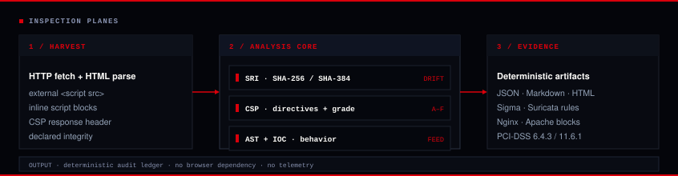

# ScriptSentinel Architecture & Internal Design

ScriptSentinel (`scriptsentinel`) is a CLI-first client-side supply-chain defense engine designed by **MONAR**. It operates out-of-band to inspect, verify, and enforce integrity across all third-party JavaScript executing inside consumer web sessions.



---

## 1. Design Thesis: The Client-Side Blind Spot

Traditional perimeter defenses (Web Application Firewalls, Next-Gen Gateways, and SIEM pipelines) inspect ingress and egress traffic arriving at your origin servers. They possess **zero visibility** into client-side DOM execution inside user browsers.

When an upstream CDN, vendor tag manager, analytics SDK, or customer chat script is tampered with:
1. Malicious payloads execute dynamically within the consumer's browser context.
2. Form fields (credit cards, CVVs, credentials, PII) are scraped directly from the DOM before form submission or encryption.
3. Harvested data is exfiltrated directly from the browser to adversary C2 endpoints using `fetch()`, `XMLHttpRequest`, or `navigator.sendBeacon()`.
4. The transaction proceeds normally to the merchant server; no server-side anomaly or error occurs.

ScriptSentinel solves this by providing **deterministic client-side verification**: automated Subresource Integrity (SRI) drift tracking, static Content-Security-Policy (CSP) misconfiguration analysis, and behavioral AST heuristics targeting Magecart and OPTIJACK skimmers.

---

## 2. System Execution Pipeline

The audit workflow executes across five sequential stages:

```
[ Target URL / DOM ]
         │
         ▼
[ 1. Harvester (Headless Chromium) ] ── Extracts inline scripts, external <script src>, CSP headers
         │
         ├───────────────────────────┬───────────────────────────┐
         ▼                           ▼                           ▼
[ 2. Cryptographic SRI ]   [ 3. CSP Analyzer ]        [ 4. Behavioral AST Scanner ]
  • SHA-256 / SHA-384        • Directive Tokenizer      • Form/CVV Harvesting (SKIM-01)
  • Base64 SRI Generation    • unsafe-eval / inline     • Keystroke Listeners (SKIM-02)
  • Baseline Drift Matcher   • Exfil Vectors (connect)  • Eval / Function Unpackers (SKIM-04)
  • Status: SCRIPT_DRIFT     • Grading Algorithm (A-F)  • C2 Domain Feeds (OPTIJACK)
         │                           │                           │
         └───────────────────────────┼───────────────────────────┘
                                     ▼
                      [ 5. Triage & Correlation ]
                        • Risk Scoring (0–100)
                        • PCI-DSS v4.0 Attestation
                                     │
         ┌───────────────────────────┴───────────────────────────┐
         ▼                                                       ▼
[ Executive Terminal / JSON ]                          [ Remediation Quick-Pack ]
  • Rich Console Tables                                  • Hardened Nonced CSP Header
  • machine-readable JSON                                • Drop-in SRI <script> Tags
                                                         • Nginx & Apache Directives
```

---

## 3. Module Breakdown

### `scriptsentinel.cli`
Entry point for command execution. Exposes commands:
- `audit <url>`: Orchestrates the target audit, fetches script inventory, performs SRI drift analysis against `--baseline <file>`, grades CSP, and prints console tables or JSON (`--output <file>`).
- `remediate <url>`: Generates drop-in server configuration blocks (Nginx, Apache), hardened CSP headers with cryptographic nonces, and verified `<script>` tags with computed SRI hashes.

### `scriptsentinel.auditor`
The orchestrator module:
- Spawns headless browser sessions (or HTTP client requests) to fetch the target DOM.
- Extracts all inline scripts, remote `<script src>` links, and response HTTP headers (`Content-Security-Policy`, `Content-Security-Policy-Report-Only`).
- Concurrently fetches external script contents while respecting timeout boundaries.

### `scriptsentinel.integrity`
The cryptographic verification engine:
- Computes SHA-256 and SHA-384 binary digests and formats standard W3C SRI strings:
  `sha256-<base64>` and `sha384-<base64>`.
- Evaluates script status against four states:
  - `VERIFIED`: Declared `integrity` matches calculated cryptographic hash.
  - `MISSING_SRI`: External script is loaded without an `integrity` attribute.
  - `INTEGRITY_MISMATCH`: Declared SRI does not match calculated hash; browser will block execution.
  - `SCRIPT_DRIFT`: Current script hash differs from a pinned baseline (`--baseline baselines.json`), proving upstream CDN tampering.

### `scriptsentinel.csp_analyzer`
Comprehensive CSP tokenizer and threat evaluator:
- Directives parsed: `default-src`, `script-src`, `script-src-elem`, `connect-src`, `form-action`, `frame-ancestors`, `report-uri`, `report-to`.
- Misconfiguration detection:
  - `CSP-MISSING`: Total absence of CSP header (Score 0, Grade F).
  - `CSP-UNSAFE-EVAL`: Permits `eval()`, `Function()`, and string-to-code compilation used by obfuscated skimmers.
  - `CSP-UNSAFE-INLINE`: Permits arbitrary inline script execution without nonce or hash verification.
  - `CSP-CONNECT-WILDCARD`: Open `connect-src *`, permitting unrestricted outbound exfiltration via `fetch()` and `sendBeacon()`.
  - `CSP-STRICT-DYNAMIC-EXFIL-RISK`: `strict-dynamic` enabled without restricting `connect-src`.
  - `CSP-REPORTING-ABSENT`: Lack of telemetry endpoints to alert SOC teams when browser violations occur.
- Health grading: 100-point penalty deduction system mapping to grades **A**, **B**, **C**, **D**, and **F**.

### `scriptsentinel.scanner`
Behavioral AST heuristic scanner:
- Scans script bodies for skimmer indicators, DOM scraping, and anti-analysis evasion.
- Rules implemented:
  - `SKIM-INPUT-HARVEST`: Regex targeting card number, CVV, expiration, password, or SSN DOM value scrapers.
  - `SKIM-DOM-LISTENER`: Interceptors hooking `input`, `change`, `keydown`, `keyup`, and `submit` events.
  - `SKIM-CLIPBOARD-TAMPER`: Direct access to `navigator.clipboard.readText()` or `writeText()`.
  - `SKIM-EVAL-EXEC`: Dynamic code evaluation via `eval()` or `new Function()`.
  - `SKIM-BASE64-UNPACK`: Runtime decoding of base64 strings (`atob()`).
  - `SKIM-EXFIL-BEACON`: Asynchronous data dispatch via `navigator.sendBeacon()`.
  - `IOC-MATCH-C2-DOMAIN`: Domain match against threat intelligence feeds.

### `scriptsentinel.iocs`
Adversary threat intelligence subsystem:
- Bundles curated IOC feeds including `malicious_c2.json` and recent campaign indicators (`optimjack_2026-11-23.json`).
- Supports extensible community threat intelligence ingestion.

### `scriptsentinel.remediate`
Remediation synthesis engine:
- Generates hardened CSP headers restricting `script-src` to verified origins and requiring per-response nonces (`'nonce-{NONCE}'`).
- Emits drop-in HTML `<script>` tags configured with `integrity="sha256-..." crossorigin="anonymous"`.
- Outputs production-ready server blocks for Nginx (`add_header`) and Apache (`Header set`).
- Generates PCI-DSS v4.0 Requirement 6.4.3 and 11.6.1 attestation checklists.

---

## 4. Performance & Operational Constraints

1. **Zero Runtime Friction**: ScriptSentinel audits happen in CI/CD pipelines, scheduled synthetic monitors, or local security scans. It introduces **0ms latency** to end-user transactions.
2. **Deterministic Outputs**: Given identical script bytes and baseline configs, ScriptSentinel produces identical cryptographic hashes and audit grades.
3. **No External Telemetry Leakage**: ScriptSentinel does not phone home or transmit audited URLs/scripts to third parties. All processing executes locally on your hardware.
